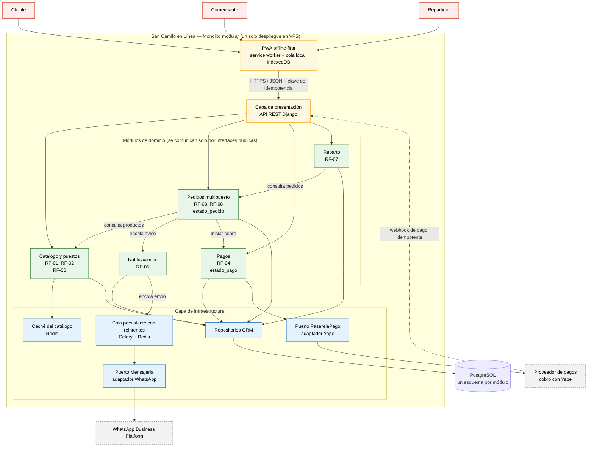
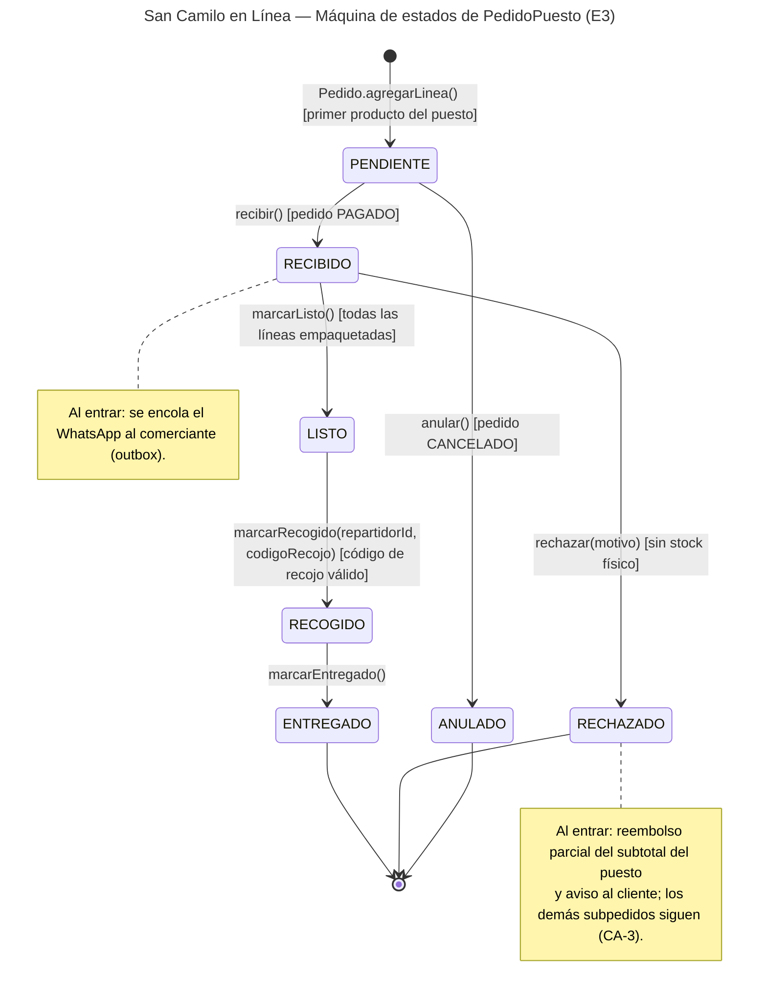
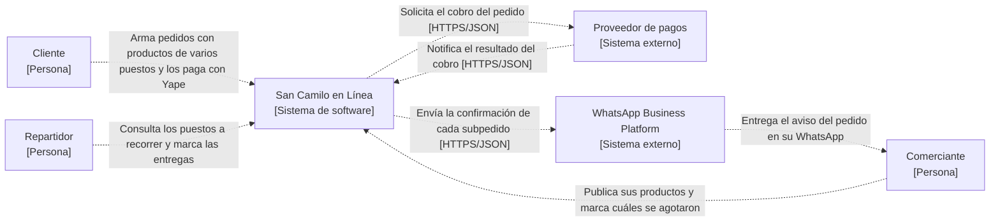

# San Camilo en Línea — Laboratorios 04, 05 y 06: arquitectura, diseño UML y modelo C4

Construcción de Software · EPIS-UNSA · 2026-B · Grupo B

## Integrantes

| Nombre | Rol en el laboratorio | Entregables |
|--------|-----------------------|-------------|
| Jhonatan Benjamin Mamani Céspedes | Analista de drivers, responsable de la matriz de decisión, diagramador (Mermaid) y redactor de ADR | E1, E2, E3, E4 |
| Jafet Martin Llave Aguilar | Diagramador (PlantUML y Python Diagrams), verificador de IA y responsable del README | E5, E6, E7, E8 |

## Caso

**San Camilo en Línea** permite a los clientes pedir productos a varios puestos del Mercado San
Camilo (Arequipa) en un solo pedido, con recojo o delivery. El pago se realiza con Yape mediante
un proveedor de pagos, y cada comerciante recibe la confirmación por WhatsApp. Los actores son
el cliente, el comerciante y el repartidor. El MVP debe estar en producción en 1 mes, con
2 developers (Python/Django) y un solo VPS de bajo costo.

**Atributo de calidad crítico:** capacidad de interacción. Un comerciante con poca experiencia
digital publica un producto en **≤ 3 toques** desde un celular de gama baja con 3G intermitente
(ver [drivers](docs/architecture/drivers.md), QA-01).

## Arquitectura elegida: monolito modular



Resultado de la [matriz de decisión](docs/architecture/matriz-decision.md):
**monolito modular 4,10** · monolito en capas 4,00 · microservicios 2,60.

## Entregables

| Código | Entregable | Archivo |
|--------|------------|---------|
| E1 | Drivers y escenarios de calidad | [drivers.md](docs/architecture/drivers.md) |
| E2 | Alternativas y matriz de decisión | [matriz-decision.md](docs/architecture/matriz-decision.md) |
| E3 | Diagrama de la arquitectura elegida (Mermaid) | [arquitectura.mmd](docs/architecture/diagramas/arquitectura.mmd) · [imagen](docs/architecture/diagramas/img/arquitectura.png) |
| E4 | Registros de decisiones arquitectónicas | [carpeta adr/](docs/architecture/adr/) |
| E5 | Alternativa descartada (PlantUML) | [alternativa.puml](docs/architecture/diagramas/alternativa.puml) · [imagen](docs/architecture/diagramas/img/alternativa.png) |
| E6 | Vista de despliegue (Python Diagrams) | [despliegue.py](docs/architecture/diagramas/despliegue.py) · [imagen](docs/architecture/diagramas/img/despliegue.png) |
| E7 | Bitácora de uso de IA | [bitacora-ia.md](docs/architecture/bitacora-ia.md) |

## Decisiones arquitectónicas

- [ADR-001: Monolito modular en Django](docs/architecture/adr/001-estilo-arquitectonico.md)
- [ADR-002: PostgreSQL con un esquema por módulo](docs/architecture/adr/002-base-de-datos.md)
- [ADR-003: PWA offline-first](docs/architecture/adr/003-estrategia-offline-pwa.md)
- [ADR-004: Puertos con tipos neutrales, sin ciclos entre módulos](docs/architecture/adr/004-puertos-sin-ciclos.md) (Lab 05)

## Reflexión sobre el uso de la IA

Consultamos a Gemini, ChatGPT y Claude, y los tres coincidieron en el monolito modular. Ese
acuerdo no reemplazó la verificación: los errores estaban en los detalles.

- **Usabilidad:** Gemini propuso un flujo "de 3 toques" que en un celular real sumó 5.
- **Disponibilidad:** sugirió hilos de Python para las notificaciones, que pierden tareas si el
  servidor se reinicia.
- **Pagos:** planteó validar Yape con una captura de pantalla, que puede falsificarse.
- **Asíncronía:** ChatGPT recomendó postergar las tareas asíncronas, aunque nuestro escenario
  QA-03 ya las exigía.
- **Alcance:** Claude nos advirtió que el equipo era de 2 integrantes y no de 3, y que la guía
  pedía diagramar la segunda mejor alternativa.

Aprendimos a contrastar cada afirmación con nuestros drivers, a hacer cálculos y pruebas propias
en lugar de aceptar cifras plausibles, y a revisar la documentación oficial antes de dar por
cierta una capacidad de un servicio externo. La IA aceleró la redacción y los diagramas, pero
las decisiones y su verificación fueron nuestras.

---

## Diseño UML (Lab 05)

Diseño detallado de la historia crítica **HU-03: pedido a varios puestos con pago único**
([historia.md](docs/design/historia.md)), coherente con ADR-001, ADR-002 y el nuevo
[ADR-004](docs/architecture/adr/004-puertos-sin-ciclos.md). Los diagramas se escriben como código
(PlantUML y Mermaid) y se verifican con las reglas de consistencia C1–C5.

| Integrante | Rol en el Lab 05 | Entregables |
|------------|------------------|-------------|
| Jhonatan Benjamin Mamani Céspedes | Historia, diagramas de clases, secuencia y estados; README y entrega | E1, E2, E3, E8 |
| Jafet Martin Llave Aguilar | Actividades, paquetes y ADR-004; código, round-trip y revisión de consistencia | E4, E5, E6, E7 |

### Máquina de estados de `PedidoPuesto` (E3)



### Entregables

| Código | Entregable | Fuente | Imagen |
|--------|------------|--------|--------|
| E1 | Historia de usuario y diagrama de clases | [historia.md](docs/design/historia.md) · [clases.puml](docs/design/clases.puml) | [PNG](docs/design/img/clases-pedidos.png) |
| E2 | Secuencia "confirmar y pagar" | [secuencia-confirmar-pagar.puml](docs/design/secuencia-confirmar-pagar.puml) | [PNG](docs/design/img/secuencia-confirmar-pagar.png) |
| E3 | Máquina de estados de PedidoPuesto | [estados-pedidopuesto.mmd](docs/design/estados-pedidopuesto.mmd) | [PNG](docs/design/img/estados-pedidopuesto.png) |
| E4 | Actividades: consolidar un pedido multipuesto | [actividades-consolidar-pedido.puml](docs/design/actividades-consolidar-pedido.puml) | [PNG](docs/design/img/actividades-consolidar-pedido.png) |
| E5 | Paquetes y ADR-004 | [paquetes.puml](docs/design/paquetes.puml) · [ADR-004](docs/architecture/adr/004-puertos-sin-ciclos.md) | [PNG](docs/design/img/paquetes.png) |
| E6 | Código, ingeniería inversa y round-trip | [src/](src/) · [round-trip.md](docs/design/round-trip.md) · [pyreverse](docs/design/classes_pedidos_pyreverse.puml) | [clases](docs/design/img/classes_pedidos.png) · [paquetes](docs/design/img/packages_sancamilo.png) |
| E7 | Consistencia C1–C5 y bitácora de IA | [consistencia.md](docs/design/consistencia.md) · [bitacora-ia.md](docs/design/bitacora-ia.md) | — |

### Cómo regenerar y probar

```bash
# Diagramas
java -jar plantuml.jar -tpng -o img docs/design/*.puml
mmdc -i docs/design/estados-pedidopuesto.mmd -o docs/design/img/estados-pedidopuesto.png
# Pruebas (una por transición de la máquina de estados + criterios de aceptación)
pip install pytest pylint
python -m pytest -q tests
# Ingeniería inversa
cd src && pyreverse -o puml -p pedidos pedidos
```

### Lo que nos dejó la revisión con IA

La IA aceleró el borrador de los diagramas y del código, pero la revisión con las reglas C1–C5 encontró
problemas reales (operaciones inexistentes en la máquina de estados, dos ciclos entre paquetes, nombres
distintos a ADR-002) y también **falsos positivos**: pedir que la notificación a WhatsApp fuera síncrona,
o marcar como error la navegación `Pedido → PedidoPuesto → LineaPedido → Producto`. Cada hallazgo se
verificó antes de aceptarlo ([consistencia.md](docs/design/consistencia.md)).

---

## Arquitectura C4 (Lab 06)

Modelo C4 de San Camilo en Línea escrito como código en un **único archivo**,
[workspace.dsl](docs/architecture/c4/workspace.dsl) (Structurizr DSL), del que se derivan las cinco
vistas. Es coherente con ADR-001 a ADR-004 y con el diseño UML del Lab 05 (los componentes son los
paquetes de [paquetes.puml](docs/design/paquetes.puml); el nivel 4, código, es el diagrama de
clases [clases.puml](docs/design/clases.puml)).

| Integrante | Rol en el Lab 06 | Entregables |
|------------|------------------|-------------|
| Jhonatan Benjamin Mamani Céspedes | Inventario y modelo (contexto, contenedores y componentes); README y entrega | E1, E2, E3, E8 |
| Jafet Martin Llave Aguilar | Vista dinámica y despliegue; exportación, revisión con IA y bitácora | E4, E5, E6, E7 |

### Diagrama de contexto (nivel 1)



### Las cinco vistas

| Nivel / vista | Imagen | C4-PlantUML | Mermaid |
|---------------|--------|-------------|---------|
| 1. Contexto | [PNG](docs/architecture/c4/img/structurizr-Contexto.png) | [puml](docs/architecture/c4/export/structurizr-Contexto.puml) | [mmd](docs/architecture/c4/export/structurizr-Contexto.mmd) |
| 2. Contenedores | [PNG](docs/architecture/c4/img/structurizr-Contenedores.png) | [puml](docs/architecture/c4/export/structurizr-Contenedores.puml) | [mmd](docs/architecture/c4/export/structurizr-Contenedores.mmd) |
| 3. Componentes de la API | [PNG](docs/architecture/c4/img/structurizr-Componentes.png) | [puml](docs/architecture/c4/export/structurizr-Componentes.puml) | [mmd](docs/architecture/c4/export/structurizr-Componentes.mmd) |
| Dinámica: confirmar y pagar | [PNG](docs/architecture/c4/img/structurizr-ConfirmarYPagar.png) | [puml](docs/architecture/c4/export/structurizr-ConfirmarYPagar.puml) | [mmd](docs/architecture/c4/export/structurizr-ConfirmarYPagar.mmd) |
| Despliegue: producción | [PNG](docs/architecture/c4/img/structurizr-Despliegue.png) | [puml](docs/architecture/c4/export/structurizr-Despliegue.puml) | [mmd](docs/architecture/c4/export/structurizr-Despliegue.mmd) |

### Entregables

| Código | Entregable | Archivo |
|--------|------------|---------|
| E1 | Inventario y contexto | [inventario.md](docs/architecture/c4/inventario.md) · [workspace.dsl](docs/architecture/c4/workspace.dsl) |
| E2 | Contenedores | [workspace.dsl](docs/architecture/c4/workspace.dsl) |
| E3 | Componentes | [workspace.dsl](docs/architecture/c4/workspace.dsl) |
| E4 | Vista dinámica | [workspace.dsl](docs/architecture/c4/workspace.dsl) · [comparacion.md](docs/architecture/c4/comparacion.md) |
| E5 | Despliegue | [workspace.dsl](docs/architecture/c4/workspace.dsl) |
| E6 | Exportación y comparación de herramientas | [export/](docs/architecture/c4/export/) · [img/](docs/architecture/c4/img/) · [contexto-manual.puml](docs/architecture/c4/contexto-manual.puml) · [comparacion.md](docs/architecture/c4/comparacion.md) |
| E7 | Revisión, comunicación y bitácora de IA | [revision-c4.md](docs/architecture/c4/revision-c4.md) · [explicacion.md](docs/architecture/c4/explicacion.md) · [bitacora-ia.md](docs/architecture/c4/bitacora-ia.md) |

### Cómo validar y regenerar las vistas

```bash
# Validar el modelo
structurizr.sh validate -w docs/architecture/c4/workspace.dsl
# Exportar a C4-PlantUML y Mermaid
structurizr.sh export -w docs/architecture/c4/workspace.dsl -f plantuml/c4plantuml -o docs/architecture/c4/export
structurizr.sh export -w docs/architecture/c4/workspace.dsl -f mermaid -o docs/architecture/c4/export
# Imágenes PNG
java -jar plantuml.jar -tpng -o ../img docs/architecture/c4/export/*.puml
# Navegación interactiva (Structurizr Lite en http://localhost:8080)
docker run -it --rm -p 8080:8080 -v "$PWD/docs/architecture/c4":/usr/local/structurizr structurizr/lite
```

### Lo que aprendimos del modelo

Pasar de UML a C4 nos obligó a decir **qué es cada caja**: un contenedor es algo que se despliega
por separado (la API, el worker, Redis, PostgreSQL), no un contenedor Docker; nuestro MVP corre con
systemd en un único VPS. Modelar una sola vez (`workspace.dsl`) evitó tener cinco diagramas
sueltos que se desactualicen. Revisión con IA y falsos positivos:
[revision-c4.md](docs/architecture/c4/revision-c4.md).


## Estructura del repositorio

```
cs-2026b-lab04-grupob/
├── README.md
├── docs/
│   ├── architecture/          # Laboratorio 04 (+ ADR-004 del Lab 05)
│   │   ├── drivers.md, matriz-decision.md, bitacora-ia.md
│   │   ├── anexos/            # respuestas completas de Gemini y ChatGPT
│   │   ├── adr/               # 000-plantilla, 001, 002, 003, 004
│   │   └── diagramas/         # arquitectura.mmd, alternativa.puml, despliegue.py, img/
│   │   └── c4/                # Laboratorio 06: workspace.dsl, export/, img/, inventario.md, revision-c4.md...
│   └── design/                # Laboratorio 05
│       ├── historia.md, clases.puml, secuencia-confirmar-pagar.puml
│       ├── estados-pedidopuesto.mmd, actividades-consolidar-pedido.puml, paquetes.puml
│       ├── classes_pedidos_pyreverse.puml, packages_sancamilo_pyreverse.puml
│       ├── round-trip.md, consistencia.md, bitacora-ia.md
│       └── img/               # PNG de todos los diagramas
├── src/                       # E6: comun, catalogo, pagos, notificaciones, pedidos, reparto
└── tests/                     # E6: pruebas derivadas de la máquina de estados y de HU-03
```
