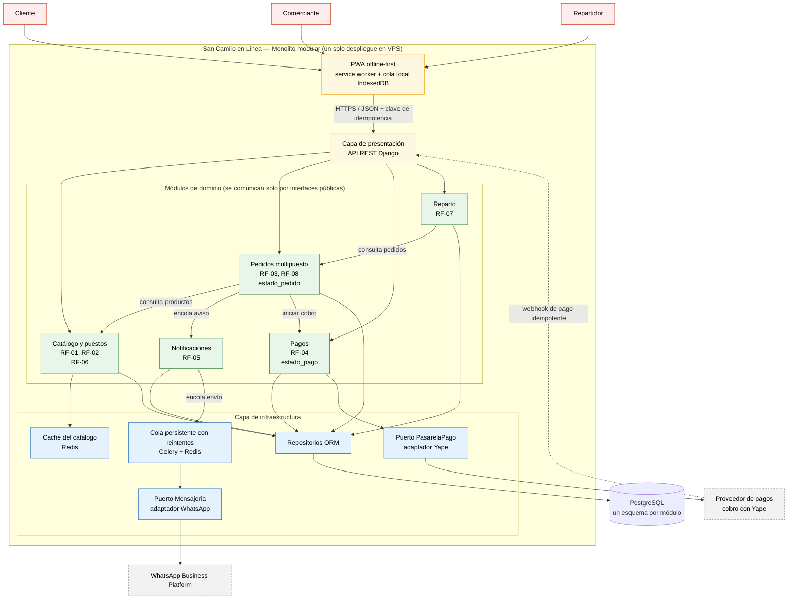
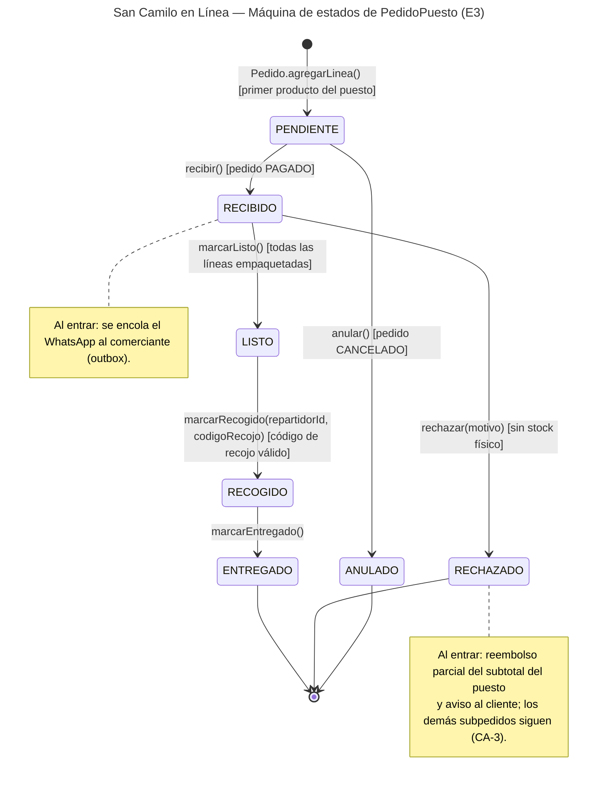

# San Camilo en Línea — Laboratorios 04 a 07: arquitectura, diseño UML, C4 y patrones

Construcción de Software · EPIS-UNSA · 2026-B · Grupo B

## Integrantes

| Nombre | Rol en el laboratorio | Entregables |
|--------|-----------------------|-------------|
| Jhonatan Benjamin Mamani Céspedes | Analista de drivers, responsable de la matriz de decisión, diagramador (Mermaid) y redactor de ADR | E1, E2, E3, E4 |
| Jafet Martin Llave Aguilar | Diagramador (PlantUML y Python Diagrams), verificador de IA y responsable del README | E5, E6, E7, E8 |

## Caso

**San Camilo en Línea** permite a los clientes pedir productos a varios puestos del Mercado San
Camilo (Arequipa) en un solo pedido, con recojo o delivery. El pago se realiza con Yape mediante
un proveedor de pagos, y cada comerciante recibe la confirmación por WhatsApp. Los actores son
el cliente, el comerciante y el repartidor. El MVP debe estar en producción en 1 mes, con
2 developers (Python/Django) y un solo VPS de bajo costo.

**Atributo de calidad crítico:** capacidad de interacción. Un comerciante con poca experiencia
digital publica un producto en **≤ 3 toques** desde un celular de gama baja con 3G intermitente
(ver [drivers](docs/architecture/drivers.md), QA-01).

## Arquitectura elegida: monolito modular



Resultado de la [matriz de decisión](docs/architecture/matriz-decision.md):
**monolito modular 4,10** · monolito en capas 4,00 · microservicios 2,60.

## Entregables

| Código | Entregable | Archivo |
|--------|------------|---------|
| E1 | Drivers y escenarios de calidad | [drivers.md](docs/architecture/drivers.md) |
| E2 | Alternativas y matriz de decisión | [matriz-decision.md](docs/architecture/matriz-decision.md) |
| E3 | Diagrama de la arquitectura elegida (Mermaid) | [arquitectura.mmd](docs/architecture/diagramas/arquitectura.mmd) · [imagen](docs/architecture/diagramas/img/arquitectura.png) |
| E4 | Registros de decisiones arquitectónicas | [carpeta adr/](docs/architecture/adr/) |
| E5 | Alternativa descartada (PlantUML) | [alternativa.puml](docs/architecture/diagramas/alternativa.puml) · [imagen](docs/architecture/diagramas/img/alternativa.png) |
| E6 | Vista de despliegue (Python Diagrams) | [despliegue.py](docs/architecture/diagramas/despliegue.py) · [imagen](docs/architecture/diagramas/img/despliegue.png) |
| E7 | Bitácora de uso de IA | [bitacora-ia.md](docs/architecture/bitacora-ia.md) |

## Decisiones arquitectónicas

- [ADR-001: Monolito modular en Django](docs/architecture/adr/001-estilo-arquitectonico.md)
- [ADR-002: PostgreSQL con un esquema por módulo](docs/architecture/adr/002-base-de-datos.md)
- [ADR-003: PWA offline-first](docs/architecture/adr/003-estrategia-offline-pwa.md)
- [ADR-004: Puertos con tipos neutrales, sin ciclos entre módulos](docs/architecture/adr/004-puertos-sin-ciclos.md) (Lab 05)
- [ADR-005: Patrones de diseño en el flujo «confirmar y pagar» y en la IA](docs/architecture/adr/005-patrones-de-diseno.md) (Lab 07)

## Reflexión sobre el uso de la IA

Consultamos a Gemini, ChatGPT y Claude, y los tres coincidieron en el monolito modular. Ese
acuerdo no reemplazó la verificación: los errores estaban en los detalles.

- **Usabilidad:** Gemini propuso un flujo "de 3 toques" que en un celular real sumó 5.
- **Disponibilidad:** sugirió hilos de Python para las notificaciones, que pierden tareas si el
  servidor se reinicia.
- **Pagos:** planteó validar Yape con una captura de pantalla, que puede falsificarse.
- **Asíncronía:** ChatGPT recomendó postergar las tareas asíncronas, aunque nuestro escenario
  QA-03 ya las exigía.
- **Alcance:** Claude nos advirtió que el equipo era de 2 integrantes y no de 3, y que la guía
  pedía diagramar la segunda mejor alternativa.

Aprendimos a contrastar cada afirmación con nuestros drivers, a hacer cálculos y pruebas propias
en lugar de aceptar cifras plausibles, y a revisar la documentación oficial antes de dar por
cierta una capacidad de un servicio externo. La IA aceleró la redacción y los diagramas, pero
las decisiones y su verificación fueron nuestras.

---

## Diseño UML (Lab 05)

Diseño detallado de la historia crítica **HU-03: pedido a varios puestos con pago único**
([historia.md](docs/design/historia.md)), coherente con ADR-001, ADR-002 y el nuevo
[ADR-004](docs/architecture/adr/004-puertos-sin-ciclos.md). Los diagramas se escriben como código
(PlantUML y Mermaid) y se verifican con las reglas de consistencia C1–C5.

| Integrante | Rol en el Lab 05 | Entregables |
|------------|------------------|-------------|
| Jhonatan Benjamin Mamani Céspedes | Historia, diagramas de clases, secuencia y estados; README y entrega | E1, E2, E3, E8 |
| Jafet Martin Llave Aguilar | Actividades, paquetes y ADR-004; código, round-trip y revisión de consistencia | E4, E5, E6, E7 |

### Máquina de estados de `PedidoPuesto` (E3)



### Entregables

| Código | Entregable | Fuente | Imagen |
|--------|------------|--------|--------|
| E1 | Historia de usuario y diagrama de clases | [historia.md](docs/design/historia.md) · [clases.puml](docs/design/clases.puml) | [PNG](docs/design/img/clases-pedidos.png) |
| E2 | Secuencia "confirmar y pagar" | [secuencia-confirmar-pagar.puml](docs/design/secuencia-confirmar-pagar.puml) | [PNG](docs/design/img/secuencia-confirmar-pagar.png) |
| E3 | Máquina de estados de PedidoPuesto | [estados-pedidopuesto.mmd](docs/design/estados-pedidopuesto.mmd) | [PNG](docs/design/img/estados-pedidopuesto.png) |
| E4 | Actividades: consolidar un pedido multipuesto | [actividades-consolidar-pedido.puml](docs/design/actividades-consolidar-pedido.puml) | [PNG](docs/design/img/actividades-consolidar-pedido.png) |
| E5 | Paquetes y ADR-004 | [paquetes.puml](docs/design/paquetes.puml) · [ADR-004](docs/architecture/adr/004-puertos-sin-ciclos.md) | [PNG](docs/design/img/paquetes.png) |
| E6 | Código, ingeniería inversa y round-trip | [src/](src/) · [round-trip.md](docs/design/round-trip.md) · [pyreverse](docs/design/classes_pedidos_pyreverse.puml) | [clases](docs/design/img/classes_pedidos.png) · [paquetes](docs/design/img/packages_sancamilo.png) |
| E7 | Consistencia C1–C5 y bitácora de IA | [consistencia.md](docs/design/consistencia.md) · [bitacora-ia.md](docs/design/bitacora-ia.md) | — |

### Cómo regenerar y probar

```bash
# Diagramas
java -jar plantuml.jar -tpng -o img docs/design/*.puml
mmdc -i docs/design/estados-pedidopuesto.mmd -o docs/design/img/estados-pedidopuesto.png
# Pruebas (una por transición de la máquina de estados + criterios de aceptación)
pip install pytest pylint
python -m pytest -q tests
# Ingeniería inversa
cd src && pyreverse -o puml -p pedidos pedidos
```

### Lo que nos dejó la revisión con IA

La IA aceleró el borrador de los diagramas y del código, pero la revisión con las reglas C1–C5 encontró
problemas reales (operaciones inexistentes en la máquina de estados, dos ciclos entre paquetes, nombres
distintos a ADR-002) y también **falsos positivos**: pedir que la notificación a WhatsApp fuera síncrona,
o marcar como error la navegación `Pedido → PedidoPuesto → LineaPedido → Producto`. Cada hallazgo se
verificó antes de aceptarlo ([consistencia.md](docs/design/consistencia.md)).

## Patrones de diseño (Lab 07)

Se refactorizó el flujo crítico **«confirmar y pagar un pedido multipuesto»** (HU-03) y se aisló la
función de IA del caso: **normalizar nombres de productos** («papa amarila» → «Papa amarilla»).
La versión ingenua se conserva en [`src/pedidos/antes/servicio.py`](src/pedidos/antes/servicio.py)
para comparar; las mismas pruebas de caracterización se ejecutan sobre las dos versiones.
Decisión registrada en [ADR-005](docs/architecture/adr/005-patrones-de-diseno.md).

| Integrante | Rol en el Lab 07 | Entregables |
|------------|------------------|-------------|
| Jhonatan Benjamin Mamani Céspedes | Versión antes y pruebas de caracterización; Strategy + Adapter + Factory; State; README y entrega | E1, E2, E3, E8 |
| Jafet Martin Llave Aguilar | Observer, Decorator, Composite y tarifas; IA aislada; métricas, diagramas y bitácora | E4, E5, E6, E7 |

### Olor → patrón → prueba

| Olor en la versión antes | Patrón | Dónde | Prueba que lo demuestra |
|--------------------------|--------|-------|-------------------------|
| `if/elif` por medio de pago | Strategy + Factory | `pagos/pasarelas.py` | `test_open_closed_nuevo_medio_sin_modificar_el_servicio` |
| El servicio conoce soles/céntimos y dict/tupla de cada SDK | Adapter | `pagos/pasarelas.py` | `test_adapters_traducen_soles_y_centimos` |
| Condicionales sobre el estado del pedido y del subpedido | State | `pedidos/estados.py` | `test_state_impide_transiciones_invalidas_del_subpedido` |
| Reintentos duplicados para Yape y Plin | Decorator | `ConReintentos` | `test_decorator_reintentos_solo_ante_timeout` |
| Avisos a comerciantes, cliente y reparto armados a mano | Observer | `comun/eventos.py` | `test_observer_nuevo_suscriptor_sin_tocar_el_servicio` |
| Bucles anidados para totalizar el pedido de varios puestos | Composite | `pedidos/pedido.py` | `test_composite_subtotal_recursivo` |
| `if/elif` de tarifas de delivery | Strategy | `pedidos/tarifas.py` | `test_strategy_tarifa_nueva_sin_tocar_el_servicio` |
| `if/elif` por proveedor de LLM y validaciones mezcladas | Strategy + Adapter + Decorator + Chain of Responsibility | `catalogo/ia.py` | `test_chain_cada_guardrail_bloquea_lo_suyo`, `test_decorator_cache_evita_llamadas_repetidas` |

Patrones rechazados: Singleton, Abstract Factory, Builder, Command y un LLM «juez» (ver
[olores.md](docs/design/patrones/olores.md)).

### Métricas (radon 6.0.1)

| Medida | Antes | Después |
|--------|-------|---------|
| Complejidad de `confirmar_y_pagar()` | 29 (D) | 2 (A) |
| Complejidad promedio | 6,07 (B) | 1,63 (A) |
| Bloque más complejo | 29 | 5 |
| Líneas de código (SLOC) | 182 | 596 |
| Archivos | 1 | 13 |
| Métodos a modificar para un medio de pago nuevo | 2 | 0 |

El refactor también corrigió dos errores que la versión antes conserva: un medio de pago desconocido
dejaba el pedido en `PENDIENTE_PAGO` con el stock reservado, y con kilos fraccionados Yape y Plin
recibían montos distintos. Detalle en [metricas.md](docs/design/patrones/metricas.md).

### Diagramas (PlantUML)

| Patrón | Fuente | Imagen |
|--------|--------|--------|
| Pagos: Strategy + Adapter + Factory + Decorator | [pagos.puml](docs/design/patrones/pagos.puml) | [PNG](docs/design/patrones/img/pagos-patrones.png) |
| State | [state.puml](docs/design/patrones/state.puml) | [PNG](docs/design/patrones/img/state-pedidopuesto.png) |
| Composite | [composite.puml](docs/design/patrones/composite.puml) | [PNG](docs/design/patrones/img/composite-pedido.png) |
| Observer | [observer.puml](docs/design/patrones/observer.puml) | [PNG](docs/design/patrones/img/observer-avisos.png) |
| Strategy (tarifas) | [tarifas.puml](docs/design/patrones/tarifas.puml) | [PNG](docs/design/patrones/img/strategy-tarifas.png) |
| IA aislada | [ia.puml](docs/design/patrones/ia.puml) | [PNG](docs/design/patrones/img/ia-aislada.png) |
| Secuencia con los patrones colaborando | [secuencia-patrones.puml](docs/design/patrones/secuencia-patrones.puml) | [PNG](docs/design/patrones/img/secuencia-patrones.png) |
| Clases del Lab 05 actualizado | [clases.puml](docs/design/clases.puml) | [PNG](docs/design/img/clases-pedidos.png) |

### Cómo probar y medir

```bash
pip install pytest radon pylint
python -m pytest -q tests                                  # 81 passed, 1 xfailed
radon cc -s -a src/pedidos/antes/servicio.py               # antes
radon cc -s -a src --exclude "src/pedidos/antes/*"         # después
```

No se necesita clave de API: los SDK de pagos y los LLM están simulados en `src/pedidos/externos.py`.
La GitHub Action [`calidad.yml`](.github/workflows/calidad.yml) ejecuta las pruebas y falla si algún
bloque de la versión con patrones supera complejidad 10.

## Estructura del repositorio

```
cs-2026b-lab04-grupob/
├── README.md
├── docs/
│   ├── architecture/          # Laboratorio 04 (+ ADR-004 del Lab 05 y ADR-005 del Lab 07)
│   │   ├── drivers.md, matriz-decision.md, bitacora-ia.md
│   │   ├── anexos/            # respuestas completas de Gemini y ChatGPT
│   │   ├── adr/               # 000-plantilla, 001 a 005
│   │   ├── c4/                # Laboratorio 06: workspace.dsl, inventario.md
│   │   └── diagramas/         # arquitectura.mmd, alternativa.puml, despliegue.py, img/
│   └── design/                # Laboratorio 05
│       ├── historia.md, clases.puml, secuencia-confirmar-pagar.puml
│       ├── estados-pedidopuesto.mmd, actividades-consolidar-pedido.puml, paquetes.puml
│       ├── classes_pedidos_pyreverse.puml, packages_sancamilo_pyreverse.puml
│       ├── round-trip.md, consistencia.md, bitacora-ia.md
│       ├── img/               # PNG de todos los diagramas
│       └── patrones/          # Laboratorio 07: olores, métricas, un .puml por patrón, bitácora
├── src/
│   ├── arranque.py            # Lab 07: raíz de composición (conecta los patrones)
│   ├── pedidos/antes/         # Lab 07: versión ingenua, solo para comparar
│   └── comun, catalogo, pagos, notificaciones, pedidos, reparto
├── tests/                     # caracterización (antes y después), patrones y máquina de estados
└── .github/workflows/         # Lab 07 (reto): pruebas y complejidad en cada push
```
