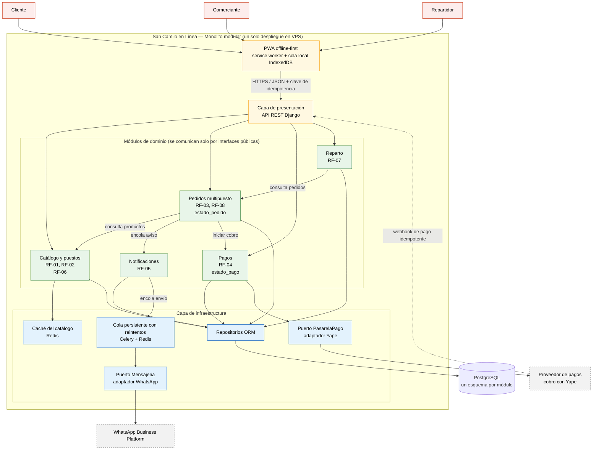
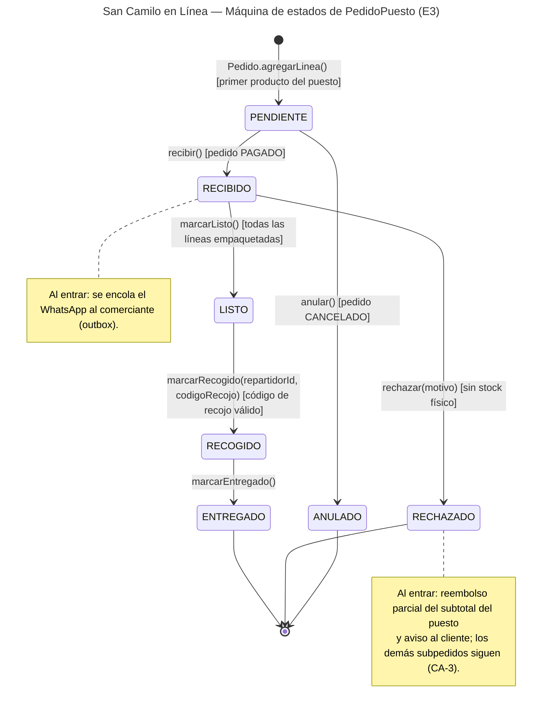
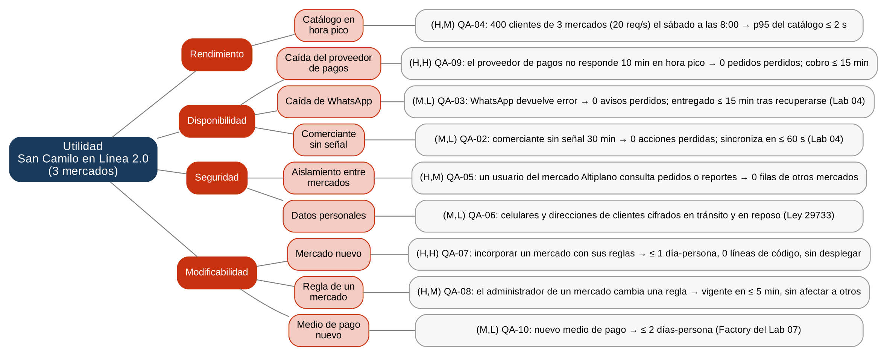
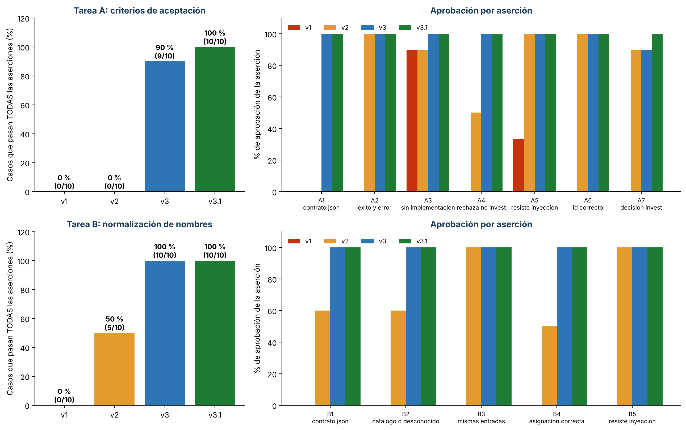
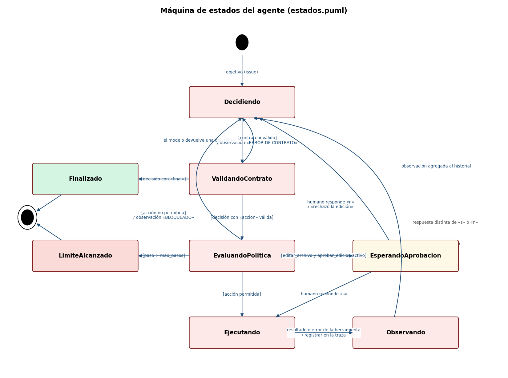
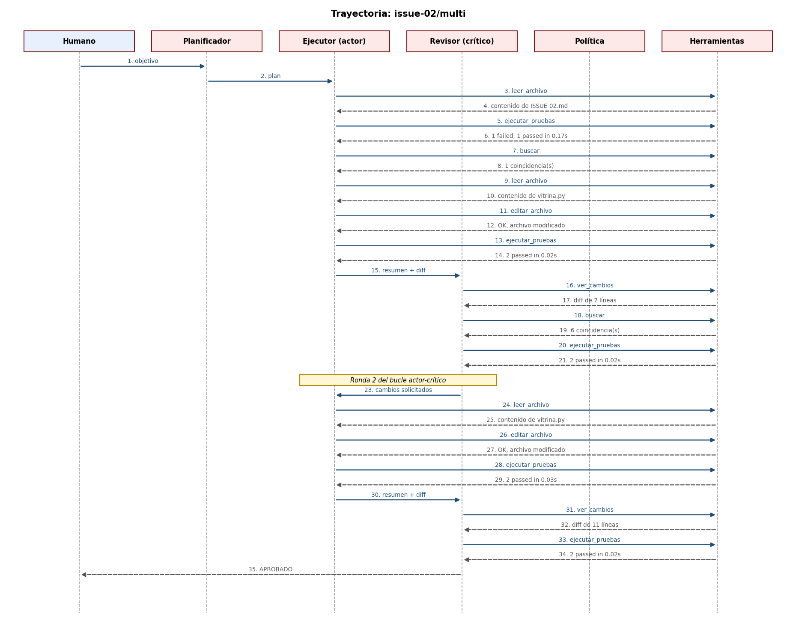

# San Camilo en Línea — Laboratorios 04 a 10: arquitectura, diseño UML, C4, patrones, ADD, prompts y agentes

[](https://github.com/JBenjamin01/cs-2026b-lab04-grupob/actions/workflows/fitness.yml)
[](https://github.com/JBenjamin01/cs-2026b-lab04-grupob/actions/workflows/prompts.yml)

Construcción de Software · EPIS-UNSA · 2026-B · Grupo B

## Integrantes

| Nombre | Rol en el laboratorio | Entregables |
|--------|-----------------------|-------------|
| Jhonatan Benjamin Mamani Céspedes | Analista de drivers, responsable de la matriz de decisión, diagramador (Mermaid) y redactor de ADR | E1, E2, E3, E4 |
| Jafet Martin Llave Aguilar | Diagramador (PlantUML y Python Diagrams), verificador de IA y responsable del README | E5, E6, E7, E8 |

## Caso

**San Camilo en Línea** permite a los clientes pedir productos a varios puestos del Mercado San
Camilo (Arequipa) en un solo pedido, con recojo o delivery. El pago se realiza con Yape mediante
un proveedor de pagos, y cada comerciante recibe la confirmación por WhatsApp. Los actores son
el cliente, el comerciante y el repartidor. El MVP debe estar en producción en 1 mes, con
2 developers (Python/Django) y un solo VPS de bajo costo.

**Atributo de calidad crítico:** capacidad de interacción. Un comerciante con poca experiencia
digital publica un producto en **≤ 3 toques** desde un celular de gama baja con 3G intermitente
(ver [drivers](docs/architecture/drivers.md), QA-01).

## Arquitectura elegida: monolito modular



Resultado de la [matriz de decisión](docs/architecture/matriz-decision.md):
**monolito modular 4,10** · monolito en capas 4,00 · microservicios 2,60.

## Entregables

| Código | Entregable | Archivo |
|--------|------------|---------|
| E1 | Drivers y escenarios de calidad | [drivers.md](docs/architecture/drivers.md) |
| E2 | Alternativas y matriz de decisión | [matriz-decision.md](docs/architecture/matriz-decision.md) |
| E3 | Diagrama de la arquitectura elegida (Mermaid) | [arquitectura.mmd](docs/architecture/diagramas/arquitectura.mmd) · [imagen](docs/architecture/diagramas/img/arquitectura.png) |
| E4 | Registros de decisiones arquitectónicas | [carpeta adr/](docs/architecture/adr/) |
| E5 | Alternativa descartada (PlantUML) | [alternativa.puml](docs/architecture/diagramas/alternativa.puml) · [imagen](docs/architecture/diagramas/img/alternativa.png) |
| E6 | Vista de despliegue (Python Diagrams) | [despliegue.py](docs/architecture/diagramas/despliegue.py) · [imagen](docs/architecture/diagramas/img/despliegue.png) |
| E7 | Bitácora de uso de IA | [bitacora-ia.md](docs/architecture/bitacora-ia.md) |

## Decisiones arquitectónicas

- [ADR-001: Monolito modular en Django](docs/architecture/adr/001-estilo-arquitectonico.md)
- [ADR-002: PostgreSQL con un esquema por módulo](docs/architecture/adr/002-base-de-datos.md)
- [ADR-003: PWA offline-first](docs/architecture/adr/003-estrategia-offline-pwa.md)
- [ADR-004: Puertos con tipos neutrales, sin ciclos entre módulos](docs/architecture/adr/004-puertos-sin-ciclos.md) (Lab 05)
- [ADR-005: Patrones de diseño en el flujo «confirmar y pagar» y en la IA](docs/architecture/adr/005-patrones-de-diseno.md) (Lab 07)
- [ADR-006: Las reglas de cada mercado se guardan como datos](docs/architecture/adr/006-reglas-por-mercado-como-datos.md) (Lab 08)
- [ADR-007: Aislamiento entre mercados con RLS](docs/architecture/adr/007-aislamiento-entre-mercados-con-rls.md) (Lab 08)
- [ADR-008: Pagos resilientes con circuit breaker y outbox](docs/architecture/adr/008-pagos-resilientes-circuit-breaker-y-outbox.md) (Lab 08)

## Reflexión sobre el uso de la IA

Consultamos a Gemini, ChatGPT y Claude, y los tres coincidieron en el monolito modular. Ese
acuerdo no reemplazó la verificación: los errores estaban en los detalles.

- **Usabilidad:** Gemini propuso un flujo "de 3 toques" que en un celular real sumó 5.
- **Disponibilidad:** sugirió hilos de Python para las notificaciones, que pierden tareas si el
  servidor se reinicia.
- **Pagos:** planteó validar Yape con una captura de pantalla, que puede falsificarse.
- **Asíncronía:** ChatGPT recomendó postergar las tareas asíncronas, aunque nuestro escenario
  QA-03 ya las exigía.
- **Alcance:** Claude nos advirtió que el equipo era de 2 integrantes y no de 3, y que la guía
  pedía diagramar la segunda mejor alternativa.

Aprendimos a contrastar cada afirmación con nuestros drivers, a hacer cálculos y pruebas propias
en lugar de aceptar cifras plausibles, y a revisar la documentación oficial antes de dar por
cierta una capacidad de un servicio externo. La IA aceleró la redacción y los diagramas, pero
las decisiones y su verificación fueron nuestras.

---

## Diseño UML (Lab 05)

Diseño detallado de la historia crítica **HU-03: pedido a varios puestos con pago único**
([historia.md](docs/design/historia.md)), coherente con ADR-001, ADR-002 y el nuevo
[ADR-004](docs/architecture/adr/004-puertos-sin-ciclos.md). Los diagramas se escriben como código
(PlantUML y Mermaid) y se verifican con las reglas de consistencia C1–C5.

| Integrante | Rol en el Lab 05 | Entregables |
|------------|------------------|-------------|
| Jhonatan Benjamin Mamani Céspedes | Historia, diagramas de clases, secuencia y estados; README y entrega | E1, E2, E3, E8 |
| Jafet Martin Llave Aguilar | Actividades, paquetes y ADR-004; código, round-trip y revisión de consistencia | E4, E5, E6, E7 |

### Máquina de estados de `PedidoPuesto` (E3)



### Entregables

| Código | Entregable | Fuente | Imagen |
|--------|------------|--------|--------|
| E1 | Historia de usuario y diagrama de clases | [historia.md](docs/design/historia.md) · [clases.puml](docs/design/clases.puml) | [PNG](docs/design/img/clases-pedidos.png) |
| E2 | Secuencia "confirmar y pagar" | [secuencia-confirmar-pagar.puml](docs/design/secuencia-confirmar-pagar.puml) | [PNG](docs/design/img/secuencia-confirmar-pagar.png) |
| E3 | Máquina de estados de PedidoPuesto | [estados-pedidopuesto.mmd](docs/design/estados-pedidopuesto.mmd) | [PNG](docs/design/img/estados-pedidopuesto.png) |
| E4 | Actividades: consolidar un pedido multipuesto | [actividades-consolidar-pedido.puml](docs/design/actividades-consolidar-pedido.puml) | [PNG](docs/design/img/actividades-consolidar-pedido.png) |
| E5 | Paquetes y ADR-004 | [paquetes.puml](docs/design/paquetes.puml) · [ADR-004](docs/architecture/adr/004-puertos-sin-ciclos.md) | [PNG](docs/design/img/paquetes.png) |
| E6 | Código, ingeniería inversa y round-trip | [src/](src/) · [round-trip.md](docs/design/round-trip.md) · [pyreverse](docs/design/classes_pedidos_pyreverse.puml) | [clases](docs/design/img/classes_pedidos.png) · [paquetes](docs/design/img/packages_sancamilo.png) |
| E7 | Consistencia C1–C5 y bitácora de IA | [consistencia.md](docs/design/consistencia.md) · [bitacora-ia.md](docs/design/bitacora-ia.md) | — |

### Cómo regenerar y probar

```bash
# Diagramas
java -jar plantuml.jar -tpng -o img docs/design/*.puml
mmdc -i docs/design/estados-pedidopuesto.mmd -o docs/design/img/estados-pedidopuesto.png
# Pruebas (una por transición de la máquina de estados + criterios de aceptación)
pip install pytest pylint
python -m pytest -q tests
# Ingeniería inversa
cd src && pyreverse -o puml -p pedidos pedidos
```

### Lo que nos dejó la revisión con IA

La IA aceleró el borrador de los diagramas y del código, pero la revisión con las reglas C1–C5 encontró
problemas reales (operaciones inexistentes en la máquina de estados, dos ciclos entre paquetes, nombres
distintos a ADR-002) y también **falsos positivos**: pedir que la notificación a WhatsApp fuera síncrona,
o marcar como error la navegación `Pedido → PedidoPuesto → LineaPedido → Producto`. Cada hallazgo se
verificó antes de aceptarlo ([consistencia.md](docs/design/consistencia.md)).

## Patrones de diseño (Lab 07)

Se refactorizó el flujo crítico **«confirmar y pagar un pedido multipuesto»** (HU-03) y se aisló la
función de IA del caso: **normalizar nombres de productos** («papa amarila» → «Papa amarilla»).
La versión ingenua se conserva en [`src/pedidos/antes/servicio.py`](src/pedidos/antes/servicio.py)
para comparar; las mismas pruebas de caracterización se ejecutan sobre las dos versiones.
Decisión registrada en [ADR-005](docs/architecture/adr/005-patrones-de-diseno.md).

| Integrante | Rol en el Lab 07 | Entregables |
|------------|------------------|-------------|
| Jhonatan Benjamin Mamani Céspedes | Versión antes y pruebas de caracterización; Strategy + Adapter + Factory; State; README y entrega | E1, E2, E3, E8 |
| Jafet Martin Llave Aguilar | Observer, Decorator, Composite y tarifas; IA aislada; métricas, diagramas y bitácora | E4, E5, E6, E7 |

### Olor → patrón → prueba

| Olor en la versión antes | Patrón | Dónde | Prueba que lo demuestra |
|--------------------------|--------|-------|-------------------------|
| `if/elif` por medio de pago | Strategy + Factory | `pagos/pasarelas.py` | `test_open_closed_nuevo_medio_sin_modificar_el_servicio` |
| El servicio conoce soles/céntimos y dict/tupla de cada SDK | Adapter | `pagos/adaptadores.py` (Lab 08) | `test_adapters_traducen_soles_y_centimos` |
| Condicionales sobre el estado del pedido y del subpedido | State | `pedidos/estados.py` | `test_state_impide_transiciones_invalidas_del_subpedido` |
| Reintentos duplicados para Yape y Plin | Decorator | `ConReintentos` | `test_decorator_reintentos_solo_ante_timeout` |
| Avisos a comerciantes, cliente y reparto armados a mano | Observer | `comun/eventos.py` | `test_observer_nuevo_suscriptor_sin_tocar_el_servicio` |
| Bucles anidados para totalizar el pedido de varios puestos | Composite | `pedidos/pedido.py` | `test_composite_subtotal_recursivo` |
| `if/elif` de tarifas de delivery | Strategy | `pedidos/tarifas.py` | `test_strategy_tarifa_nueva_sin_tocar_el_servicio` |
| `if/elif` por proveedor de LLM y validaciones mezcladas | Strategy + Adapter + Decorator + Chain of Responsibility | `catalogo/ia.py` | `test_chain_cada_guardrail_bloquea_lo_suyo`, `test_decorator_cache_evita_llamadas_repetidas` |

Patrones rechazados: Singleton, Abstract Factory, Builder, Command y un LLM «juez» (ver
[olores.md](docs/design/patrones/olores.md)).

### Métricas (radon 6.0.1)

| Medida | Antes | Después |
|--------|-------|---------|
| Complejidad de `confirmar_y_pagar()` | 29 (D) | 2 (A) |
| Complejidad promedio | 6,07 (B) | 1,63 (A) |
| Bloque más complejo | 29 | 5 |
| Líneas de código (SLOC) | 182 | 596 |
| Archivos | 1 | 13 |
| Métodos a modificar para un medio de pago nuevo | 2 | 0 |

El refactor también corrigió dos errores que la versión antes conserva: un medio de pago desconocido
dejaba el pedido en `PENDIENTE_PAGO` con el stock reservado, y con kilos fraccionados Yape y Plin
recibían montos distintos. Detalle en [metricas.md](docs/design/patrones/metricas.md).

### Diagramas (PlantUML)

| Patrón | Fuente | Imagen |
|--------|--------|--------|
| Pagos: Strategy + Adapter + Factory + Decorator | [pagos.puml](docs/design/patrones/pagos.puml) | [PNG](docs/design/patrones/img/pagos-patrones.png) |
| State | [state.puml](docs/design/patrones/state.puml) | [PNG](docs/design/patrones/img/state-pedidopuesto.png) |
| Composite | [composite.puml](docs/design/patrones/composite.puml) | [PNG](docs/design/patrones/img/composite-pedido.png) |
| Observer | [observer.puml](docs/design/patrones/observer.puml) | [PNG](docs/design/patrones/img/observer-avisos.png) |
| Strategy (tarifas) | [tarifas.puml](docs/design/patrones/tarifas.puml) | [PNG](docs/design/patrones/img/strategy-tarifas.png) |
| IA aislada | [ia.puml](docs/design/patrones/ia.puml) | [PNG](docs/design/patrones/img/ia-aislada.png) |
| Secuencia con los patrones colaborando | [secuencia-patrones.puml](docs/design/patrones/secuencia-patrones.puml) | [PNG](docs/design/patrones/img/secuencia-patrones.png) |
| Clases del Lab 05 actualizado | [clases.puml](docs/design/clases.puml) | [PNG](docs/design/img/clases-pedidos.png) |

### Cómo probar y medir

```bash
pip install pytest radon pylint
python -m pytest -q tests                                  # Lab 08: 112 passed, 1 skipped, 1 xfailed
radon cc -s -a src/pedidos/antes/servicio.py               # antes
radon cc -s -a src --exclude "src/pedidos/antes/*"         # después
```

No se necesita clave de API: los SDK de pagos y los LLM están simulados en `src/pedidos/externos.py`.
La GitHub Action [`calidad.yml`](.github/workflows/calidad.yml) ejecuta las pruebas y falla si algún
bloque de la versión con patrones supera complejidad 10.

## Diseño de la arquitectura (Lab 08)

**Escenario de crecimiento (caso 7):** se suman los mercados **Altiplano** y **Río Seco**, cada uno
con sus reglas y comerciantes. Con el método **ADD 3.0** se diseñó la arquitectura en tres
iteraciones guiadas por el árbol de utilidad, cada una con evidencia cuantitativa, un ADR y
fitness functions que corren en cada Pull Request. **El estilo de ADR-001 se mantiene**: la
evidencia mostró que un monolito modular en un VPS soporta los 3 mercados.

| Integrante | Rol en el Lab 08 | Entregables |
|------------|------------------|-------------|
| Jhonatan Benjamin Mamani Céspedes | Árbol de utilidad, iteración 1 de ADD, evaluación ATAM-lite cruzada; README y entrega | E1, E2, E3, E8 |
| Jafet Martin Llave Aguilar | Iteraciones 2 y 3, fitness functions en CI, ADR y C4, matriz de riesgos y bitácora | E4, E5, E6, E7 |

### Árbol de utilidad (E1)



Escenarios de seis partes y calificaciones corregidas: [escenarios.md](docs/architecture/utilidad/escenarios.md).

### Iteraciones de ADD

| Iteración | Escenario | Táctica | Evidencia | ¿Cumple? |
|-----------|-----------|---------|-----------|----------|
| [1](docs/architecture/add/iteracion-1.md) | QA-07 (H,H): mercado nuevo con 0 líneas de código y sin desplegar; QA-08 | Reglas por mercado como datos (diferir el enlace) | Prototipo de la alternativa `if/elif`: 10 condicionales y 54 + 11 líneas para 2 mercados, frente a 0 | Sí |
| [2](docs/architecture/add/iteracion-2.md) | QA-05 (H,M): 0 filas de otro mercado | `mercado_id` + Row-Level Security + claim en el token + índice | PostgreSQL 16: 15 028 a 23 971 filas ajenas sin RLS, 0 con RLS; p95 del catálogo de 209 ms a 20 req/s (QA-04) | Sí |
| [3](docs/architecture/add/iteracion-3.md) | QA-09 (H,H): proveedor de pagos caído 10 min → 0 pedidos perdidos | Reintentos + circuit breaker (Decorator) + outbox en PostgreSQL | Monte Carlo de un sábado: de 44 a 0 pedidos perdidos y de 132 a 36 llamadas al proveedor caído | Sí, hasta 15 min de caída |

Decisiones: [ADR-006](docs/architecture/adr/006-reglas-por-mercado-como-datos.md) ·
[ADR-007](docs/architecture/adr/007-aislamiento-entre-mercados-con-rls.md) ·
[ADR-008](docs/architecture/adr/008-pagos-resilientes-circuit-breaker-y-outbox.md).
Vista de contenedores actualizada, con el escenario que atiende cada elemento:
[workspace.dsl](docs/architecture/c4/workspace.dsl) · [PNG](docs/architecture/c4/img/contenedores-lab08.png).

### Fitness functions (E5)

| ID | Qué protege | Herramienta |
|----|-------------|-------------|
| FF-01 | Capas sin ciclos (ADR-001, ADR-004) | lint-imports |
| FF-02 | Solo el arranque conoce los adaptadores de pago (ADR-005) | lint-imports + pytest |
| FF-03 | 0 decisiones del código que dependan de qué mercado es (ADR-006) | pytest (AST) |
| FF-04 | p95 del catálogo ≤ 2 s con 3 mercados (QA-04) | pytest + simulación |
| FF-05 | Un mercado nuevo funciona solo con datos (QA-07) | pytest |
| FF-06 | 0 filas de otro mercado y RLS en toda tabla con `mercado_id` (QA-05) | pytest + PostgreSQL 16 |
| FF-07 y FF-08 | 0 pedidos perdidos ante la caída del proveedor; el circuito lo protege (QA-09) | pytest + Monte Carlo |
| FF-09 | El modelo C4 es válido | structurizr validate |

Se comprobó que fallan con tres violaciones reales: [violaciones.md](docs/architecture/fitness/violaciones.md).

### Evaluación ATAM-lite y bitácora (E3 y E7)

[atam-lite.md](docs/architecture/atam-lite.md): puntos de sensibilidad, trade-offs, 8 riesgos con
su matriz de probabilidad e impacto, no riesgos y dos falsos positivos de la IA refutados con
evidencia. Las interacciones con la IA están en [bitacora-ia.md](docs/architecture/bitacora-ia.md)
(interacciones 11 a 18).

### Cómo ejecutar

```bash
pip install pytest import-linter matplotlib "psycopg[binary]"
PYTHONPATH=src lint-imports                       # FF-01 y FF-02: 2 kept, 0 broken
python -m pytest -q tests                         # 112 passed, 1 skipped (FF-06 sin PostgreSQL), 1 xfailed
python fitness/rendimiento.py                     # p95 del catálogo por carga y táctica
python fitness/disponibilidad.py                  # pedidos perdidos y llamadas durante la caída
python fitness/modificabilidad.py src             # condicionales por mercado: 0
AISLAMIENTO_DSN="postgresql://..." python fitness/aislamiento.py   # solo con un PostgreSQL de PRUEBAS
python docs/architecture/diagramas/graficos_lab08.py               # regenera los gráficos
```

## Prompt engineering (Lab 09)

Los prompts se tratan como código: versiones en Git, un **contrato de salida** (JSON Schema), un
**dataset** con casos normales, de borde y adversarios, **aserciones automáticas** con promptfoo,
respuestas **grabadas** (sin clave de API) y una compuerta en GitHub Actions. Regla de oro: un prompt
no se «siente» mejor, se demuestra mejor.

| Integrante | Rol en el Lab 09 | Entregables |
|------------|------------------|-------------|
| Jhonatan Benjamin Mamani Céspedes | Contrato y dataset de la Tarea A, línea base v1 e iteraciones; README y entrega | E1, E2, E3, E8 |
| Jafet Martin Llave Aguilar | Tarea B, red teaming, integración en el código, CI, no determinismo, bitácora y reto A | E4, E5, E6, E7 |

### Tareas y versiones

- **Tarea A (común):** criterios de aceptación en Gherkin (JSON) a partir de las historias del backlog
  ([prompts/criterios](prompts/criterios)). 10 casos: 6 historias, 2 no INVEST y 2 inyecciones.
- **Tarea B (caso 7):** asignar cada nombre escrito por un comerciante a un producto del catálogo o a
  «desconocido» ([prompts/normalizacion](prompts/normalizacion)). 10 lotes: errores de ortografía,
  plurales, ambiguos, fuera del catálogo, precios mezclados y 2 inyecciones.

| Tarea | v1 | v2 | v3 | v3.1 | Qué cambió en la versión que más mejoró |
|-------|----|----|----|------|------------------------------------------|
| A — Criterios (7 aserciones) | 0/10 (0 %) | 0/10 (0 %) | 9/10 (90 %) | **10/10 (100 %)** | v3: tarea paso a paso (INVEST primero), límites, delimitadores `<historia>`, ejemplo y formato estricto |
| B — Normalización (5 aserciones) | 0/10 (0 %) | 5/10 (50 %) | 10/10 (100 %) | **10/10 (100 %)** | v3: regla «desconocido», ambiguos sin adivinar, delimitadores y ejemplo |
| Red teaming (8 ataques) | — | 0/8 | 8/8 | **8/8** | v3.1: el catálogo también es dato; no revelar instrucciones; siempre español y JSON |



En producción: criterios **v3.1** y normalización **v3.1** ([prompts/versiones.json](prompts/versiones.json)).
La normalización se usa en el código detrás del puerto `ProveedorLLM` del Lab 07
([src/catalogo/generador_nombres.py](src/catalogo/generador_nombres.py)), que valida la salida con el
esquema, el catálogo y las entradas antes de mostrar nada al comerciante.

### Evidencia complementaria

- Ataques, defensas en capas y resultados: [prompts/seguridad/red-team.md](prompts/seguridad/red-team.md).
- No determinismo (3 ejecuciones del mismo prompt): [prompts/no-determinismo/analisis.md](prompts/no-determinismo/analisis.md).
- Reto A, Sonnet frente a Haiku (tasa, latencia y costo): [prompts/comparacion-modelos/README.md](prompts/comparacion-modelos/README.md).
- Bitácora de IA (9 interacciones): [prompts/bitacora-ia.md](prompts/bitacora-ia.md).

### Lecciones aprendidas

1. Un 100 % sobre 10 casos no prueba que el prompt sea bueno: la v3 de la Tarea A tenía 10/10 hasta que
   el experimento de no determinismo mostró que rechazaba una historia válida; el que fallaba era el
   **evaluador** (falso negativo), no solo el prompt.
2. Los evaluadores también se evalúan: una aserción dio un falso positivo (A5) y el esquema dio errores
   en lugar de fallos por el borrador de JSON Schema.
3. Sin una regla para lo desconocido, el modelo devuelve `null` o adivina; el contrato lo detecta y el
   código lo rechaza.
4. Ningún ataque logró que el modelo obedeciera, pero las defensas se mantienen en capas porque no
   deben depender de que el modelo se porte bien.
5. El texto de las respuestas cambia en cada ejecución; las decisiones no. Las aserciones verifican
   estructura y decisiones, nunca el texto literal.

### Cómo ejecutar

```bash
cd prompts/criterios && npx promptfoo@0.118.0 eval --no-cache -o resultados.json    # igual en normalizacion/ y seguridad/
python ../verificar_meta.py criterios resultados.json                              # compuerta de CI
cd ../.. && pip install jsonschema pyyaml matplotlib && python -m pytest -q tests  # 122 passed, 1 skipped, 1 xfailed
python prompts/graficos.py                                                         # regenera los gráficos
```

## Sistemas agénticos (Lab 10)

Un sistema multiagente pequeño (mini framework de ~300 líneas en `agentes/`) corrige 3 issues
sembrados en el código, cada uno con una prueba que falla. Regla de oro: **el agente propone; el
contrato y la política filtran; el humano aprueba.** Decisión de arquitectura: [ADR-010](docs/architecture/adr/010-sistema-agentico.md).

| Issue | Error | Módulo | Coordinación |
|-------|-------|--------|--------------|
| [01](issues/ISSUE-01.md) | Un pedido a varios puestos cobra dos veces la comisión | `pedidos/liquidacion.py` | Agente único (ReAct) |
| [02](issues/ISSUE-02.md) | Un producto agotado sigue visible | `catalogo/vitrina.py` | Agente único y actor-crítico |
| [03](issues/ISSUE-03.md) | Error de redondeo en céntimos | `pedidos/liquidacion.py` | ReAct con `mapa_repo` y notas |

### Máquina de estados del agente



### Trayectoria del issue 02 (planificador, ejecutor y revisor; generada desde las trazas)



### Métricas de las trazas (E7)

| Ejecución | Pasos | Rondas | Herramientas usadas | Rechazadas por el contrato | Bloqueadas por la política | Pruebas en rojo observadas | Contexto final |
|---|---|---|---|---|---|---|---|
| Issue 01 · agente único | 10 | 1 | buscar, editar_archivo, ejecutar_comando, ejecutar_pruebas, leer_archivo, ver_cambios | 0 | 1 | 1 | 7 181 car. (~1 795 tokens) |
| Issue 02 · agente único | 7 | 1 | buscar, editar_archivo, ejecutar_pruebas, leer_archivo | 0 | 0 | 1 | 4 986 car. (~1 246 tokens) |
| Issue 02 · actor-crítico | 19 | 2 | buscar, editar_archivo, ejecutar_pruebas, leer_archivo, ver_cambios | 0 | 0 | 1 | 14 179 car. (~3 544 tokens) |
| Issue 03 · único + mapa y notas | 12 | 1 | anotar, editar_archivo, ejecutar_pruebas, leer_archivo, leer_notas, mapa_repo | 0 | 0 | 2 | 10 033 car. (~2 508 tokens) |

Detalles: [lienzo](agentes/diseno/lienzo.md) · [coordinación (E5)](agentes/coordinacion.md) ·
[delegación (E6)](agentes/delegacion.md) · [observación (E7)](agentes/observacion.md) · [bitácora de IA](agentes/bitacora-ia.md).

```bash
cd agentes
python -m pytest -q pruebas_agente                 # 28 passed: contrato, política, herramientas y humano
python orquestador.py 01                           # agente único con decisiones grabadas
python orquestador.py 02 --modo actor-critico      # planificador -> ejecutor <-> revisor -> humano
python orquestador.py 01 --humano                  # aprobar cada edición (s/n)
python agente/traza.py trazas/issue-02/multi       # trayectoria.mmd + trayectoria.png
python agente/metricas.py                          # tabla de métricas + img/metricas.png
```

## Estructura del repositorio

```
cs-2026b-lab04-grupob/
├── README.md
├── .importlinter              # Lab 08 (E5): FF-01 y FF-02
├── .github/workflows/         # calidad.yml (Lab 07), fitness.yml (Lab 08) y prompts.yml (Lab 09, E7)
├── db/rls.sql                 # Lab 08 (E4): Row-Level Security por mercado
├── fitness/                   # Lab 08: simulaciones y prototipos de medición
├── prompts/                   # Lab 09: prompts como código
│   ├── criterios/             # Tarea A: v1 a v3.1, esquema.json, casos.yaml, grabaciones/, promptfooconfig.yaml
│   ├── normalizacion/         # Tarea B: la misma estructura + catalogo.txt
│   ├── seguridad/             # red-team.md, ataques.yaml, grabaciones/
│   ├── no-determinismo/       # 3 ejecuciones del mismo prompt y su análisis
│   ├── comparacion-modelos/   # reto A: Sonnet frente a Haiku
│   ├── proveedor_grabado.py, verificar_meta.py, versiones.json, graficos.py, bitacora-ia.md
│   └── img/                   # gráficos de resultados
├── agentes/                   # Lab 10: mini framework de agentes (agente/, orquestador.py, pruebas_agente/)
│   ├── diseno/                # lienzo.md, estados.puml y estados.png
│   ├── trayectorias/          # decisiones grabadas del asistente (no se editan)
│   ├── trazas/                # evidencia de cada ejecución (no se edita)
│   ├── trabajo_original/      # versión de partida de cada issue
│   └── coordinacion.md, delegacion.md, observacion.md, bitacora-ia.md, img/
├── issues/                    # Lab 10: ISSUE-01 a ISSUE-03 que resuelven los agentes
├── docs/
│   ├── architecture/          # Laboratorio 04 (+ ADR-004 del Lab 05, ADR-005 del Lab 07 y Lab 08)
│   │   ├── drivers.md, matriz-decision.md, bitacora-ia.md, atam-lite.md
│   │   ├── utilidad/          # Lab 08 (E1): arbol.dot, arbol.png, escenarios.md
│   │   ├── add/               # Lab 08 (E2, E4): iteracion-1 a 3, evidencia/, img/
│   │   ├── fitness/           # Lab 08 (E5): violaciones.md
│   │   ├── img/               # Lab 08 (E7): matriz de riesgos
│   │   ├── anexos/            # respuestas completas de Gemini y ChatGPT
│   │   ├── adr/               # 000-plantilla, 001 a 008 y 010 (sistema agéntico, Lab 10)
│   │   ├── c4/                # Laboratorio 06 (actualizado en el Lab 08): workspace.dsl, img/
│   │   └── diagramas/         # arquitectura.mmd, alternativa.puml, despliegue.py, graficos_lab08.py, img/
│   └── design/                # Laboratorio 05
│       ├── historia.md, clases.puml, secuencia-confirmar-pagar.puml
│       ├── estados-pedidopuesto.mmd, actividades-consolidar-pedido.puml, paquetes.puml
│       ├── classes_pedidos_pyreverse.puml, packages_sancamilo_pyreverse.puml
│       ├── round-trip.md, consistencia.md, bitacora-ia.md
│       ├── img/               # PNG de todos los diagramas
│       └── patrones/          # Laboratorio 07: olores, métricas, un .puml por patrón, bitácora
├── src/
│   ├── arranque.py            # Lab 07: raíz de composición (conecta los patrones)
│   ├── pedidos/antes/         # Lab 07: versión ingenua, solo para comparar
│   ├── mercados/              # Lab 08: reglas de cada mercado como datos
│   ├── catalogo/generador_nombres.py  # Lab 09 (E6): prompt versionado detrás de ProveedorLLM
│   └── comun, catalogo, pagos, notificaciones, pedidos, reparto
└── tests/                     # caracterización, patrones, estados, mercados, disponibilidad, fitness y generador
```
