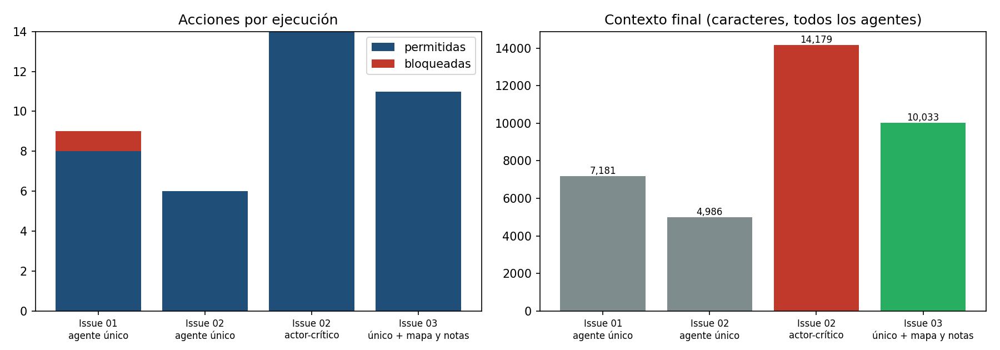
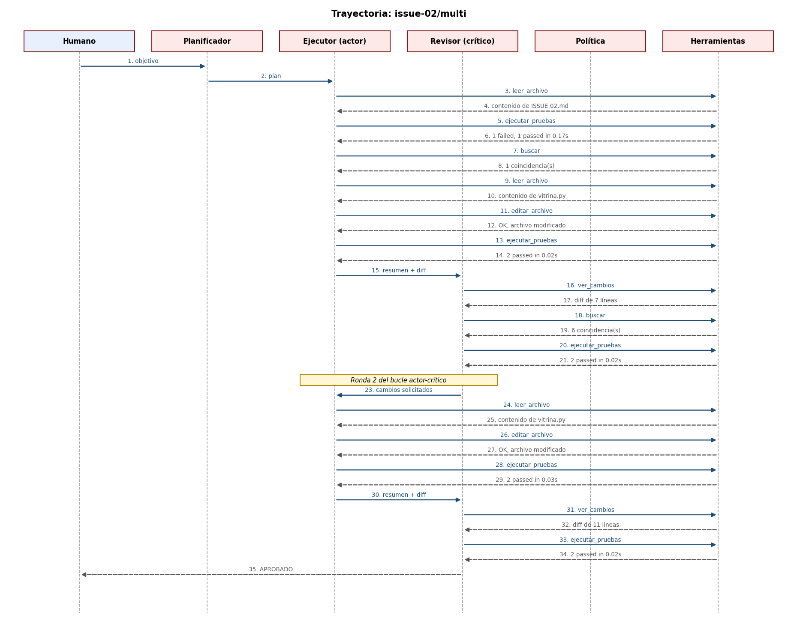

# E7 — Observación del sistema agéntico

Métricas calculadas por `python agente/metricas.py` a partir de las trazas JSONL (`trazas/issue-NN/<variante>/`)
y de los `resumen.json` que escribe el orquestador. «Pasos» cuenta las decisiones de todos los agentes,
incluida la respuesta final. El contexto final es el tamaño del historial de cada agente al terminar
(1 token ≈ 4 caracteres).

| Ejecución | Pasos | Rondas | Herramientas usadas | Rechazadas por el contrato | Bloqueadas por la política | Pruebas en rojo observadas | Contexto final |
|---|---|---|---|---|---|---|---|
| Issue 01 · agente único | 10 | 1 | buscar, editar_archivo, ejecutar_comando, ejecutar_pruebas, leer_archivo, ver_cambios | 0 | 1 | 1 | 7 181 car. (~1 795 tokens) |
| Issue 02 · agente único | 7 | 1 | buscar, editar_archivo, ejecutar_pruebas, leer_archivo | 0 | 0 | 1 | 4 986 car. (~1 246 tokens) |
| Issue 02 · actor-crítico | 19 | 2 | buscar, editar_archivo, ejecutar_pruebas, leer_archivo, ver_cambios | 0 | 0 | 1 | 14 179 car. (~3 544 tokens) |
| Issue 03 · único + mapa y notas | 12 | 1 | anotar, editar_archivo, ejecutar_pruebas, leer_archivo, leer_notas, mapa_repo | 0 | 0 | 2 | 10 033 car. (~2 508 tokens) |

## Diagrama de una trayectoria

Issue 02 con actor-crítico (`trazas/issue-02/multi/trayectoria.mmd`, generado por `agente/traza.py`):

## Lectura de las trazas

| Pregunta | Respuesta según las trazas |
|----------|----------------------------|
| ¿Se resolvieron los issues? | Sí: las 3 pruebas de los issues pasan y ninguna prueba se modificó por un agente (la política protege `tests/`). `python -m pytest -q tests` → 128 passed, 1 skipped, 1 xfailed. |
| ¿Cuántos pasos y rondas? | 48 decisiones en 4 ejecuciones; solo el issue 02 con actor-crítico usó 2 rondas. |
| ¿Qué detuvo la política? | 1 acción: `git checkout -b fix/issue-01` (issue 01). Crear ramas es tarea del humano. |
| ¿Qué rechazó el contrato? | 0 decisiones en las trayectorias. Las 7 decisiones inválidas de `pruebas_agente` (E3) demuestran que se rechazarían. |
| ¿Qué errores del agente se detectaron? | Issue 03: el primer arreglo usó `quantize` sin `ROUND_HALF_UP` y **la prueba** lo rechazó. Issue 02: el agente único dejó la búsqueda sin corregir y **el revisor** lo detectó. |
| ¿Cuánto contexto consumió? | El mayor historial individual fue el del ejecutor del issue 03 (10 033 caracteres, ~2 500 tokens): `mapa_repo` incluyó también `mercados/reglas.py` y `pedidos/tarifas.py`. |
| E4: ¿mapa y notas redujeron pasos o contexto frente a E2? | **Pasos, no contexto.** El issue 03 leyó 1 solo archivo de código (en E2 hizo falta `buscar` + leer) y las notas conservaron la hipótesis y el error. Pero el contexto subió (10 033 frente a 7 181), porque el mapa entrega firmas de todos los módulos del sandbox y el catálogo de herramientas creció. En un repositorio grande el mapa ahorra más; en uno pequeño, `buscar` es más barato. |
| ¿Qué intervención humana falta? | Aprobar cada edición (`--humano`), aplicar el cambio (`--aplicar`) y aprobar y fusionar el Pull Request. |
