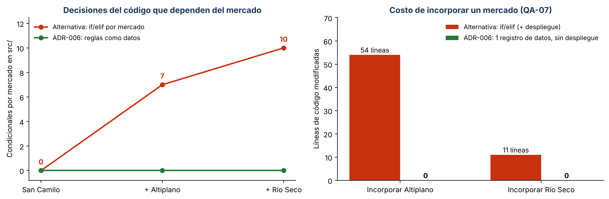

# Iteración 1 de ADD: reglas por mercado (QA-07 y QA-08)

| Paso de ADD | Resultado |
|-------------|-----------|
| 1. Entradas | `drivers.md` y ADR-001 (Lab 04), `workspace.dsl` (Lab 06), ADR-005 (Lab 07), árbol de utilidad (E1) |
| 2. Objetivo | **QA-07 (H,H):** incorporar un mercado con sus reglas en ≤ 1 día-persona, con 0 líneas de código y sin desplegar. **QA-08 (H,M):** cambiar una regla de un mercado en ≤ 5 min, sin despliegue y sin afectar a los otros. |
| 3. Elemento a refinar | Módulo Pedidos (`pedidos/servicio.py`, `pedidos/tarifas.py`) y un módulo nuevo: Mercados |
| 4. Conceptos de diseño | Ver la tabla 1 |
| 5. Instanciación | Módulo `src/mercados/`: `ReglasMercado` (valores por mercado, validados), puerto `RepositorioMercados` y `datos_iniciales.json` con los 3 mercados. `ServicioPedidos` recibe el repositorio y aplica las reglas del mercado del pedido. |
| 6. Vistas y decisiones | Componente «Módulo Mercados» en `c4/workspace.dsl`; [ADR-006](../adr/006-reglas-por-mercado-como-datos.md) |
| 7. Análisis | QA-07 y QA-08 se cumplen (tabla 2 y pruebas). Quedan dos riesgos para la evaluación ATAM-lite: una regla mal escrita ya no pasa por revisión de código, y el aislamiento entre mercados todavía no existe. |

## 1. Conceptos de diseño evaluados (Prompt IA 2)

| Concepto | Propuesta de la IA | Qué mejora | Qué empeora | Decisión del equipo |
|----------|--------------------|------------|-------------|---------------------|
| Un despliegue (VPS) por mercado | «Aislamiento total y reglas independientes» | Aislamiento y reglas propias | Triplica el costo (R-03) y la operación para 2 developers (R-02); un bug se corrige 3 veces | **Rechazada** |
| `if/elif` por mercado en el código | Táctica implícita («es lo más rápido») | Nada que configurar | Cada mercado o cambio de regla toca el código y exige desplegar: incumple QA-07 y QA-08 | **Rechazada con evidencia** (tabla 2) |
| Motor de reglas genérico (DSL o librería de reglas) | «Máxima flexibilidad para reglas futuras» | Reglas arbitrarias sin código | Curva de aprendizaje y pruebas difíciles; las reglas reales son 6 valores por mercado | **Rechazada:** sobreingeniería para 1 mes |
| Reglas como **datos** (tabla por mercado) + Strategy de tarifas del Lab 07 | Táctica «diferir el enlace: configuración en BD» | Mercado o regla nuevos sin código ni despliegue | Hay que validar los datos: un error de tipeo ya no lo atrapa una revisión de código (riesgo R3) | **Aceptada** (ADR-006) |

## 2. Evidencia: prototipo de la alternativa y de la táctica

Para no decidir «a ojo», se implementó también la alternativa `if/elif` en una rama descartada,
sobre el código del Lab 07, incorporando primero Altiplano y luego Río Seco. Los cambios reales
están en [`evidencia/alternativa-if-elif-altiplano.diff`](evidencia/alternativa-if-elif-altiplano.diff)
y [`evidencia/alternativa-if-elif-rio-seco.diff`](evidencia/alternativa-if-elif-rio-seco.diff).
Los condicionales se contaron con [`fitness/modificabilidad.py`](../../../fitness/modificabilidad.py),
que recorre el AST y cuenta las comparaciones `mercado == "..."`.

| Medida | Alternativa `if/elif` | Táctica: reglas como datos (ADR-006) |
|--------|-----------------------|--------------------------------------|
| Condicionales por mercado en `src/` (1 → 2 → 3 mercados) | 0 → **7** → **10** | 0 → 0 → **0** |
| Incorporar Altiplano | 3 archivos, **54 líneas** de código + despliegue | 1 registro de datos (12 campos), **0 líneas**, sin despliegue |
| Incorporar Río Seco | 2 archivos, **11 líneas** de código + despliegue | 1 registro de datos, **0 líneas**, sin despliegue |
| Cambiar el pedido mínimo de un mercado (QA-08) | Editar código, revisar y desplegar | Editar un dato; vigente al recargar la caché de reglas |
| Pruebas del Lab 07 que se rompieron | **2** (el medio TARJETA quedó fuera de la lista fija de medios y un pedido de S/ 2,63 quedó bajo el pedido mínimo) | 0 |
| Costo único | — | Módulo `mercados`: 101 líneas (SLOC) + 2 métodos en `ServicioPedidos` |

**Lectura:** con `if/elif`, cada mercado agrega 3 condicionales y obliga a desplegar. Además, la
lista fija de medios por mercado rompió el principio abierto/cerrado que el Lab 07 había logrado con
la Factory (la prueba `test_open_closed_nuevo_medio_sin_modificar_el_servicio` falló). Con reglas
como datos, el costo único (unas 100 líneas) se paga una vez y cada mercado posterior cuesta 0
líneas de código.

**Pruebas:** `tests/test_mercados.py` (17 casos): pedido mínimo, medios aceptados, delivery y comisión
de cada mercado; cambiar una regla de Altiplano no afecta a San Camilo (QA-08); y 5 configuraciones
inválidas se rechazan antes de guardarse (comisión de 150 %, monto negativo, sin medios de pago,
horario invertido, código con espacios).

## 3. Supuestos

- S1. En producción, las reglas viven en la tabla `mercados_mercado` (editable desde el administrador
  de Django) y se cachean como máximo 5 min; `datos_iniciales.json` es la carga inicial.
- S2. Los valores de Altiplano y Río Seco (pedido mínimo, zonas, comisión, horario) son de ejemplo y
  deben confirmarse con cada mercado. Cambiarlos no requiere tocar el código.
- S3. San Camilo conserva sus reglas actuales: sin pedido mínimo, con Yape y Plin, y las mismas
  zonas de delivery del Lab 07.

## 4. ¿Se cumplen los escenarios?

| Escenario | Medida | Resultado |
|-----------|--------|-----------|
| QA-07 | 0 líneas de código y sin despliegue | **Cumple:** Río Seco y un cuarto mercado de prueba (FF-05) funcionan solo con datos |
| QA-08 | Sin despliegue y sin afectar a otros mercados | **Cumple:** `test_cambiar_una_regla_no_afecta_a_otros_mercados` |
