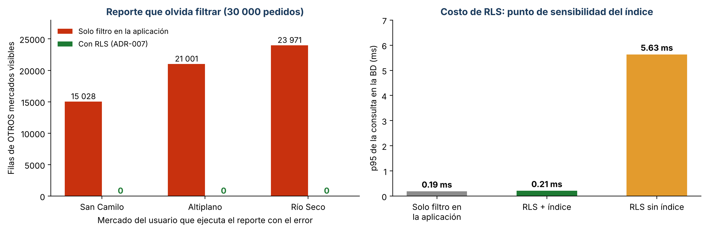
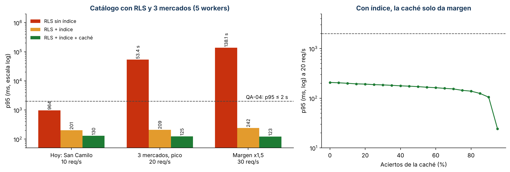

# Iteración 2 de ADD: aislamiento entre mercados (QA-05), verificando QA-04

| Paso de ADD | Resultado |
|-------------|-----------|
| 1. Entradas | Árbol de utilidad, iteración 1, ADR-002 (un esquema por módulo) y el riesgo R1 de la evaluación ATAM-lite (E3): «sin aislamiento, un mercado ve los pedidos de otro» |
| 2. Objetivo | **QA-05 (H,M):** un usuario del mercado Altiplano nunca ve filas de otro mercado, aunque una consulta olvide filtrar. Se verifica además que **QA-04** (p95 ≤ 2 s con 20 req/s) se siga cumpliendo con las tácticas elegidas. |
| 3. Elemento a refinar | Base de datos (PostgreSQL) y la entrada a la API (token y middleware) |
| 4. Conceptos de diseño | Ver la tabla 1 |
| 5. Instanciación | Columna `mercado_id` en cada tabla de datos de un mercado; índice `(mercado_id, creado)`; políticas RLS forzadas ([`db/rls.sql`](../../../db/rls.sql)); rol de aplicación sin `BYPASSRLS`; un middleware fija `app.mercado_id` con el claim `mercado` del token en cada transacción. |
| 6. Vistas y decisiones | «Base de datos (PostgreSQL 16 + RLS) [QA-04, QA-05]» y «API [QA-05]» en `c4/workspace.dsl`; [ADR-007](../adr/007-aislamiento-entre-mercados-con-rls.md) |
| 7. Análisis | QA-05 cumple con 0 filas ajenas; QA-04 cumple con p95 de 209 ms. El índice es un punto de sensibilidad. |

## 1. Alternativas evaluadas (comparación; el aislamiento no se simula, se prueba)

| Alternativa | Aislamiento (QA-05) | Mercado nuevo (QA-07) | Encaje con ADR-002 | Decisión |
|-------------|---------------------|-----------------------|--------------------|----------|
| Una base de datos por mercado | Muy alto | Lento: crear BD, migrar y configurar | 3 bases × 6 esquemas en un VPS | **Rechazada:** operación compleja para 2 developers |
| Un esquema por mercado (propuesta de la IA: librería de multitenencia por esquemas) | Alto | Medio: migraciones por esquema | **Choca:** ADR-002 ya usa un esquema por módulo; serían 18 esquemas | **Rechazada** |
| Columna `mercado_id` + filtro solo en la aplicación | Depende de que **ninguna** consulta olvide el filtro | Rápido: un registro | Encaja | **Rechazada con evidencia** (tabla 2) |
| Columna `mercado_id` + filtro en la aplicación + **Row-Level Security** + claim en el token | Alto, si RLS está bien configurado; falla cerrado | Rápido: un registro | Encaja | **Aceptada** (ADR-007); genera el riesgo R5 |

## 2. Evidencia: prueba sobre PostgreSQL 16 real

[`fitness/aislamiento.py`](../../../fitness/aislamiento.py) carga 30 000 pedidos de los 3 mercados
(50 %, 30 % y 20 %) y, actuando como el rol de la aplicación, ejecuta un reporte con un error
típico: **olvida** el `WHERE mercado_id = ...`. También mide 400 veces la consulta más frecuente
(panel de pedidos recientes de un mercado).

| Variante | Filas de otros mercados que ve San Camilo / Altiplano / Río Seco | Sin mercado en el token | p95 de la consulta frecuente |
|----------|------------------------------------------------------------------|-------------------------|------------------------------|
| Solo filtro en la aplicación | **15 028 / 21 001 / 23 971** | 30 000 (todo) | 0,19 ms |
| RLS + índice `(mercado_id, creado)` | **0 / 0 / 0** | **0** (falla cerrado) | 0,21 ms |
| RLS sin índice | 0 / 0 / 0 | 0 | **5,63 ms** (×27) |

Medido en PostgreSQL 16.15 local; los milisegundos cambian según la máquina, pero no la relación
entre variantes. Se repitió dos veces con resultados equivalentes (0,18 a 0,21 ms con índice;
5,63 a 6,35 ms sin índice).

## 3. Verificación de QA-04 con las tácticas elegidas

RLS agrega un filtro a cada consulta, así que se volvió a simular el catálogo con
[`fitness/rendimiento.py`](../../../fitness/rendimiento.py) (cola M/G/c adaptada del ejemplo del
docente, 5 workers de Gunicorn):

| Carga | RLS sin índice | RLS + índice | RLS + índice + caché |
|-------|----------------|--------------|----------------------|
| Hoy: solo San Camilo (10 req/s) | 964 ms | 201 ms | 130 ms |
| 3 mercados, hora pico (20 req/s) | **53,4 s** (saturado) | **209 ms** | 125 ms |
| Margen ×1,5 (30 req/s) | 138,1 s | 242 ms | 123 ms |

**Lectura:** el índice por mercado es imprescindible: sin él, con 3 mercados la API se satura
(utilización mayor al 100 %). Con el índice, QA-04 se cumple con holgura **sin depender de la caché**
(209 ms frente a 2 000 ms). La caché del ADR-001 solo agrega margen. Por eso no se escala a un
segundo VPS ni se cambia el estilo arquitectónico.

## 4. Supuestos

- S1. Carga: 200 clientes concurrentes en San Camilo (QA-04 del Lab 04), 120 en Altiplano y 80 en
  Río Seco; cada cliente activo pide el catálogo cada ~20 s → 20 req/s en hora pico.
- S2. Tiempos de servicio tomados del MVP de AgroConecta (guía del Lab 08), porque San Camilo aún no
  tiene mediciones propias; sin índice, +20 % por recorrer las filas de 3 mercados. Si el MVP real
  fuera más lento, el margen de 10× ante el presupuesto absorbe el error; el reto opcional A
  (prueba de carga real) es la forma de confirmarlo.
- S3. Sobrecosto de RLS: +5 %, medido en la tabla 2.
- S4. La conexión de la aplicación usa un rol sin `BYPASSRLS` y que no es dueño de las tablas.

## 5. ¿Se cumplen los escenarios?

| Escenario | Medida | Resultado |
|-----------|--------|-----------|
| QA-05 | 0 filas de otros mercados | **Cumple** con RLS, incluso con el reporte defectuoso |
| QA-04 | p95 ≤ 2 s a 20 req/s | **Cumple:** 209 ms con RLS + índice, sin caché |
