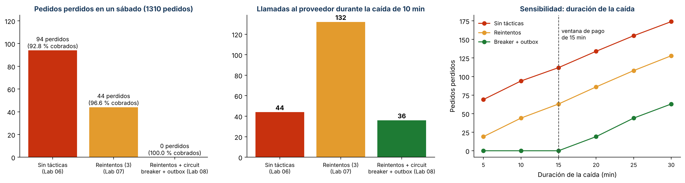

# Iteración 3 de ADD: pagos ante la caída del proveedor (QA-09)

| Paso de ADD | Resultado |
|-------------|-----------|
| 1. Entradas | Árbol de utilidad, puerto `PasarelaPago` y Decorator `ConReintentos` (ADR-005), outbox de avisos (ADR-001) y el riesgo R2 de la evaluación ATAM-lite (E3): «con el código del Lab 07, si el proveedor no responde, el pago queda EXPIRADO y el pedido se **cancela**» |
| 2. Objetivo | **QA-09 (H,H):** el proveedor de pagos no responde durante 10 min en hora pico del sábado → 0 pedidos perdidos; cobro ≤ 15 min después de confirmar. |
| 3. Elemento a refinar | Módulo Pagos, `ServicioPedidos.confirmar_y_pagar()` y el worker de Celery |
| 4. Conceptos de diseño | Ver la tabla 1 |
| 5. Instanciación | `pagos/resiliencia.py`: `ConCircuitBreaker` (Decorator de `PasarelaPago`; umbral 3, espera 60 s). `pagos/pendientes.py`: outbox `ColaPagosPendientes` (tabla `pagos.pago_pendiente`). `ServicioPedidos` difiere el cobro en vez de cancelar, y `reintentar_pagos_pendientes()` lo ejecuta el worker cada minuto. La fábrica guarda **una** instancia por medio, porque el circuito debe recordar las fallas. |
| 6. Vistas y decisiones | «Worker [QA-03, QA-09]», «Planificador [QA-09]» y «Módulo Pagos [QA-09]» en `c4/workspace.dsl`; [ADR-008](../adr/008-pagos-resilientes-circuit-breaker-y-outbox.md) |
| 7. Análisis | QA-09 se cumple para caídas de hasta 15 min. La ventana de pago de 15 min es un punto de sensibilidad. |

## 1. Conceptos de diseño evaluados (Prompt IA 2)

| Concepto | Propuesta de la IA | Qué mejora | Qué empeora | Decisión del equipo |
|----------|--------------------|------------|-------------|---------------------|
| Más reintentos (10 con espera creciente) | «Subir los reintentos resuelve la caída» | Resiste caídas cortas | Bloquea la petición del cliente varios minutos y multiplica las llamadas al proveedor caído | **Rechazada** |
| Segundo proveedor de pagos (failover) | «Contratar un proveedor de respaldo» | Disponibilidad alta | Nuevo convenio, costo y conciliación doble; no cabe en 1 mes (R-01, R-03) | **Rechazada para el MVP** |
| Solo outbox, sin circuit breaker | «Basta con guardar el cobro pendiente» | No se pierde el pedido | Durante la caída, cada pedido nuevo espera 3 timeouts antes de diferirse y el proveedor caído recibe todas esas llamadas | **Corregida:** se agrega el circuit breaker |
| Outbox en Redis (ya está en el VPS como broker) | Variante para no crear una tabla | Sin migración | Si Redis se reinicia sin persistencia, los cobros pendientes se pierden; ADR-001 ya guarda la outbox de avisos en PostgreSQL por esa razón | **Rechazada:** la outbox va en PostgreSQL |
| Reintentos (Lab 07) + **circuit breaker** (Decorator) + **outbox en PostgreSQL** | Versión corregida | 0 pedidos perdidos; protege al proveedor caído | Consistencia eventual: el cliente ve «pago pendiente» hasta ≤ 15 min; riesgo de cobro duplicado (R7) | **Aceptada** (ADR-008) |

## 2. Evidencia: Monte Carlo de un sábado con 3 mercados

[`fitness/disponibilidad.py`](../../../fitness/disponibilidad.py), adaptado del ejemplo del docente:
sábado de 06:00 a 14:00, 1 310 pedidos de los 3 mercados con hora pico de 7:00 a 10:00, 5 % de
timeouts transitorios y una **caída total** del proveedor a las 08:30.

| Táctica | Pedidos perdidos (caída de 10 min) | % cobrado | Llamadas al proveedor caído | Demora máxima del cobro |
|---------|------------------------------------|-----------|-----------------------------|-------------------------|
| Sin tácticas (Lab 06) | 94 | 92,8 % | 44 | — |
| Reintentos ×3 (Lab 07, código actual) | 44 | 96,6 % | **132** | — |
| Reintentos + circuit breaker + outbox (Lab 08) | **0** | **100 %** | **36** | 10 min |

| Duración de la caída | 5 min | 10 min | 15 min | 20 min | 25 min | 30 min |
|----------------------|-------|--------|--------|--------|--------|--------|
| Pedidos perdidos con breaker + outbox | 0 | 0 | 0 | 19 | 44 | 63 |

**Lectura:** los reintentos del Lab 07 resisten timeouts sueltos, pero ante una caída triplican las
llamadas al proveedor caído (132) y aun así pierden 44 pedidos. El circuit breaker deja de llamar
tras 3 fallas y la outbox guarda el cobro: 0 pedidos perdidos y 73 % menos llamadas. Si la caída
supera la ventana de pago de 15 min, los pedidos más antiguos vencen y se cancelan: es el **punto de
sensibilidad** de esta decisión (riesgo R6).

**Error corregido en la propia simulación:** en la primera versión, las llegadas de pedidos y las
fallas del proveedor usaban el mismo generador aleatorio, así que cada táctica recibía una cantidad
distinta de pedidos (1 252, 1 271 y 1 280): la comparación no era justa. Se separaron los dos
generadores y ahora las tres tácticas reciben los mismos 1 310 pedidos.

**Pruebas:** `tests/test_disponibilidad.py` (8 casos): el circuito se abre tras 3 fallas y deja de
llamar; el estado semiabierto se cierra o se reabre; con el proveedor caído el pedido queda
`PENDIENTE_PAGO` en la outbox con el stock reservado; al recuperarse, el worker cobra los
pendientes; si sigue caído, no insiste; pasados 15 min, se cancela y libera el stock; y si el
webhook ya resolvió el pago, el worker no cobra dos veces.

## 3. Cambio de comportamiento deliberado

La prueba de caracterización del Lab 07 `test_tres_timeouts_cancelan_el_pedido` pasó a llamarse
`test_tres_timeouts_no_cobran_el_pedido`: en la versión antes el pedido sigue quedando `CANCELADO`,
y en la versión actual queda `PENDIENTE_PAGO`. Es el cambio que pide QA-09 y está registrado en
ADR-008.

## 4. Supuestos

- S1. Pedidos de los 3 mercados por hora: 90 (6:00), 240 (7:00 a 10:00), 150 (10:00 a 12:00) y 90
  (12:00 a 14:00). Deben recalibrarse con los datos reales del primer mes.
- S2. La caída empieza en la hora pico (el peor caso) y el 5 % de timeouts es independiente entre
  llamadas.
- S3. La autorización de pago del cliente sigue vigente durante la ventana de 15 min. **Pregunta
  abierta al proveedor:** si la invalida antes, el pedido diferido se cancela y se pide pagar de nuevo.
- S4. El proveedor acepta el `pedido_id` como clave de idempotencia; si no, un reintento después de
  un timeout ambiguo podría cobrar dos veces (riesgo R7).

## 5. ¿Se cumple el escenario?

| Escenario | Medida | Resultado |
|-----------|--------|-----------|
| QA-09 | 0 pedidos perdidos con una caída de 10 min; cobro ≤ 15 min | **Cumple:** 0 perdidos, demora máxima de 10 min. Con caídas de más de 15 min se pierden pedidos (riesgo R6, aceptado). |
