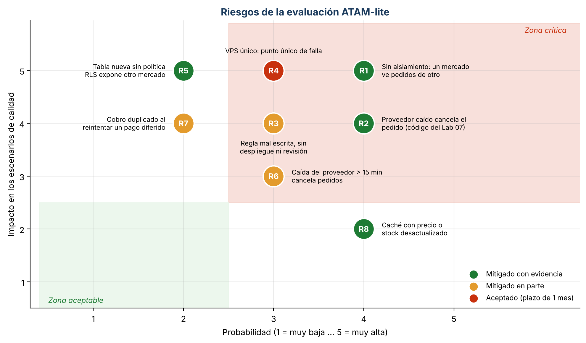

# Evaluación ATAM-lite — San Camilo en Línea 2.0 (E3 y E7, Lab 08)

Evaluación de una sesión sobre el árbol de utilidad, las tres iteraciones de ADD, los ADR-006 a
ADR-008, la vista de contenedores y los resultados de las simulaciones. Tuvo dos fuentes:

1. **Evaluación cruzada (E3):** otro grupo revisó el repositorio y abrió un issue (sección 3).
2. **Evaluador adversario (Prompt IA 3):** la IA actuó como evaluador escéptico. Cada hallazgo se
   verificó contra la evidencia y dos de ellos resultaron falsos positivos (sección 2.5).

La primera ronda (E3) se hizo después de la iteración 1 y encontró los riesgos R1 a R4. R1 y R2 son
críticos y por eso se convirtieron en las iteraciones 2 y 3. Los riesgos R5 a R8 aparecieron al
revisar esas iteraciones (E7).

## 1. Prompt usado (Prompt IA 3)

```
Actúa como evaluador ATAM escéptico. Te paso el árbol de utilidad, los ADR-006 a 008, la vista de
contenedores y los resultados de las simulaciones [pegar]. Para cada escenario (H,*) identifica:
puntos de sensibilidad, puntos de trade-off, riesgos y no riesgos. Para cada riesgo indica
probabilidad e impacto (1 a 5) y una pregunta incómoda que el equipo debería poder responder.
No propongas rediseños completos; cita la evidencia que te falta.
```

## 2. Hallazgos

### 2.1 Puntos de sensibilidad

| Decisión o parámetro | Atributo que depende de él | Evidencia |
|----------------------|----------------------------|-----------|
| Índice `(mercado_id, ...)` en cada tabla con RLS | Rendimiento (QA-04) | Sin índice, la consulta frecuente pasa de 0,21 a 5,63 ms (×27) y el catálogo se satura a 20 req/s (p95 de 53 s) |
| Ventana de pago de 15 min | Disponibilidad (QA-09) | Con caídas de hasta 15 min se pierden 0 pedidos; con 20 min, 19; con 30 min, 63 |
| Validación de los datos de un mercado | Modificabilidad (QA-07) e integridad | 5 configuraciones inválidas se rechazan; un valor válido pero equivocado pasa |

### 2.2 Puntos de trade-off

| Decisión | Mejora | Empeora | Respuesta del equipo |
|----------|--------|---------|----------------------|
| Reglas como datos (ADR-006) | Modificabilidad: 0 líneas por mercado | Verificabilidad: un cambio de regla no pasa por revisión de código ni por CI | Validación al guardar; registro de auditoría pendiente (R3) |
| RLS (ADR-007) | Seguridad: 0 filas ajenas aunque una consulta falle | Operación: configuración delicada en cada tabla nueva | FF-06 revisa el catálogo de PostgreSQL en cada PR (R5) |
| Outbox de pagos (ADR-008) | Disponibilidad: 0 pedidos perdidos | Consistencia: el cliente ve «pago pendiente» hasta 15 min | Aceptado: es mejor que cancelar el pedido |

### 2.3 Riesgos

| ID | Riesgo | Prob. | Imp. | Pregunta incómoda | Respuesta o mitigación | Estado |
|----|--------|-------|------|-------------------|------------------------|--------|
| R1 | Sin aislamiento, un usuario de un mercado ve los pedidos de otro (E3) | 4 | 5 | «¿Qué impide que un reporte olvide el filtro por mercado?» | Iteración 2: RLS forzado + claim en el token; 0 filas ajenas medidas | **Mitigado** (ADR-007, FF-06) |
| R2 | Si el proveedor no responde, `ConReintentos` devuelve EXPIRADO y el pedido se cancela (E3) | 4 | 4 | «¿Cuántos pedidos se pierden si el proveedor cae 10 min un sábado?» | Iteración 3: de 44 a 0 pedidos perdidos | **Mitigado** (ADR-008, FF-07) |
| R3 | Una regla mal escrita se publica sin despliegue ni revisión (E3) | 3 | 4 | «¿Quién revisa que la comisión de Río Seco sea 3 % y no 30 %?» | Validación al guardar (comisión ≤ 15 %, montos ≥ 0) y pruebas; falta auditoría de cambios | **Mitigado en parte** |
| R4 | Un solo VPS es punto único de falla de los 3 mercados (E3) | 3 | 5 | «¿Cuánto tarda en volver si el VPS se cae un sábado?» | Respaldo diario de PostgreSQL y plan de recuperación en ≤ 2 h; un segundo VPS duplica el costo (R-03) | **Aceptado** para el plazo de 1 mes |
| R5 | Una tabla nueva sin política RLS, o un rol con `BYPASSRLS`, expone otro mercado | 2 | 5 | «¿Qué pasa con la primera migración que agregue una tabla?» | FF-06 falla si una tabla con `mercado_id` no tiene RLS forzado | **Mitigado** |
| R6 | Una caída del proveedor de más de 15 min cancela pedidos | 3 | 3 | «¿La ventana de 15 min es del negocio o del proveedor?» | Sensibilidad medida (19 pedidos con 20 min); se avisará al cliente para que pague de nuevo | **Mitigado en parte** |
| R7 | Un reintento diferido tras un timeout ambiguo cobra dos veces | 2 | 4 | «¿El proveedor acepta una clave de idempotencia?» | Se envía el `pedido_id` y el webhook es idempotente (ADR-002); falta confirmarlo con el proveedor | **Mitigado en parte** |
| R8 | La caché del catálogo muestra precio o stock desactualizado | 4 | 2 | «¿Qué ve el cliente si el puesto se quedó sin papa?» | El stock se valida al confirmar el pedido (Lab 05); con índice, la caché no es necesaria para QA-04 | **Mitigado** |



Fuente: `diagramas/graficos_lab08.py`. En la zona crítica (probabilidad ≥ 3 e impacto ≥ 3) quedan
abiertos R3, R4 y R6. R4 se acepta por el plazo y el presupuesto. R3 y R6 tienen mitigación parcial
y una acción pendiente.

### 2.4 No riesgos

| Decisión | Por qué es segura | Evidencia |
|----------|-------------------|-----------|
| Mantener el monolito modular en un VPS con 3 mercados | QA-04 se cumple con 10 veces de margen | p95 de 209 ms frente a 2 000 ms a 20 req/s (RLS + índice, sin caché) |
| El worker de Celery puede reintentar los pagos diferidos | En la hora pico llegan unos 4 pedidos/min; tras una caída de 10 min, la outbox tiene unos 40 cobros | La simulación los cobra en el primer minuto tras la recuperación |

### 2.5 Hallazgos de la IA refutados con evidencia (falsos positivos)

| Hallazgo de la IA | Verificación | Decisión |
|-------------------|--------------|----------|
| «RLS degrada el rendimiento del catálogo con 3 mercados» | Medido en PostgreSQL 16: 0,19 ms sin RLS y 0,21 ms con RLS + índice | **Falso positivo:** el sobrecosto real (+5 %) es despreciable; el riesgo verdadero es olvidar el índice (sensibilidad 2.1) |
| «Con el circuito abierto se pierden los pagos que llegan» | `test_con_el_circuito_abierto_no_se_llama_al_proveedor_y_nada_se_pierde` y FF-07 | **Falso positivo:** con el circuito abierto el cobro va a la outbox; 0 pedidos perdidos |

## 3. Evaluación cruzada recibida (E3)

No se recibió ninguna evaluación cruzada en este repositorio: al 31/10/2026 la pestaña Issues no
tiene ningún issue (0 abiertos, 0 cerrados). Queda pendiente coordinar con el grupo evaluador que
asigne el docente. Los hallazgos de la sección 2 provienen únicamente del evaluador adversario
(Prompt IA 3), verificados contra la evidencia del equipo.

## 4. Evaluación entregada a otro grupo (E3)

No se abrió ningún issue de evaluación en el repositorio de otro grupo. Pendiente de asignación y
de coordinación con el grupo evaluado.