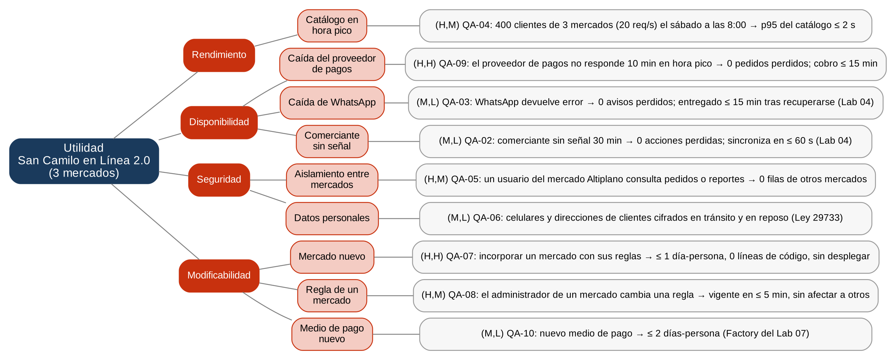

# Árbol de utilidad — San Camilo en Línea 2.0 (E1, Lab 08)

**Escenario de crecimiento (caso 7):** se suman los mercados **Altiplano** y **Río Seco**, cada uno
con sus propias reglas y comerciantes. Las restricciones siguen vigentes: 1 mes para adaptar el
sistema, 2 developers Python/Django (R-02), un solo VPS (R-03) y el monolito modular de ADR-001,
salvo que la evidencia obligue a cambiarlo.

Fuente: [`arbol.dot`](arbol.dot) (`dot -Tpng arbol.dot -o arbol.png`).

## 1. Escenarios de seis partes

Los escenarios QA-02, QA-03 y QA-04 vienen de `drivers.md` (Lab 04); QA-04 se actualiza con la carga
de los 3 mercados. QA-05 a QA-10 son nuevos. QA-01 (publicar en ≤ 3 toques) sigue vigente, pero no
cambia con el crecimiento y no entra en este árbol.

| ID | Atributo | Fuente | Estímulo | Entorno | Artefacto | Respuesta | Medida | (Imp., Dif.) |
|----|----------|--------|----------|---------|-----------|-----------|--------|--------------|
| QA-04 | Rendimiento | 400 clientes de los 3 mercados (200 + 120 + 80) | Abren el catálogo de un puesto (≈ 20 req/s) | Sábado de 7:00 a 10:00, VPS de 2 vCPU con 5 workers | API, módulo Catálogo y PostgreSQL | Devuelve los productos del puesto | p95 ≤ 2 s | (H,M) |
| QA-09 | Disponibilidad | Proveedor de pagos | No responde durante 10 min | Hora pico del sábado (≈ 4 pedidos/min) | Módulo Pagos | El pedido queda pendiente y se cobra cuando el proveedor vuelve | 0 pedidos perdidos; cobro ≤ 15 min después de confirmar | (H,H) |
| QA-03 | Disponibilidad | WhatsApp Business Platform | Devuelve error 500 | Operación normal, pedido pagado | Módulo Notificaciones | El aviso se encola y se reintenta | 0 avisos perdidos; entregado ≤ 15 min tras recuperarse | (M,L) |
| QA-02 | Disponibilidad | Comerciante | Publica o marca agotado sin señal | Sin conexión hasta 30 min | PWA (IndexedDB) | Se guarda localmente y se sincroniza | 0 acciones perdidas; sincroniza ≤ 60 s | (M,L) |
| QA-05 | Seguridad | Comerciante o administrador del mercado Altiplano | Consulta pedidos, ventas o reportes | Operación normal, incluso si una consulta olvida filtrar por mercado | API y PostgreSQL | Solo ve los datos de su mercado | 0 filas de otros mercados | (H,M) |
| QA-06 | Seguridad | Persona no autorizada | Intenta leer celulares o direcciones de clientes | En tránsito o en el disco del VPS | PWA, API y PostgreSQL | Los datos viajan por HTTPS y el disco está cifrado | 0 datos personales legibles (Ley 29733) | (M,L) |
| QA-07 | Modificabilidad | Equipo de San Camilo en Línea | Debe incorporar un mercado nuevo con sus reglas | Sistema en producción | Módulos Mercados y Pedidos | El mercado opera con sus reglas | ≤ 1 día-persona, 0 líneas de código, sin despliegue | (H,H) |
| QA-08 | Modificabilidad | Administrador de un mercado | Cambia una regla (pedido mínimo, zonas, horario) | Sistema en producción | Módulo Mercados | La regla nueva rige solo para su mercado | Vigente en ≤ 5 min, sin despliegue, 0 cambios en otros mercados | (H,M) |
| QA-10 | Modificabilidad | Equipo | Debe agregar un medio de pago | Sistema en producción | Módulo Pagos | Se agrega un adaptador y se registra en la fábrica | ≤ 2 días-persona (Factory del Lab 07) | (M,L) |

## 2. Calificaciones corregidas por el equipo (Prompt IA 1)

| Escenario | Propuesta de la IA | Corrección del equipo | Justificación |
|-----------|--------------------|-----------------------|---------------|
| QA-04 | (H,H): «la carga se duplica» | (H,M) | Cálculo rápido: 20 req/s × 0,11 s / 5 workers = 0,44 de utilización. Es importante, pero no es lo más difícil; se verificará con simulación. |
| QA-05 | (M,L): «basta un WHERE mercado_id» | (H,M) | Los mercados compiten entre sí: ver las ventas de otro es grave. Y basta un reporte que olvide el WHERE para exponerlo todo. |
| QA-04 | Medida «el catálogo responde rápido» | p95 ≤ 2 s | «Rápido» no es medible. |
| — | «Soportar 10 000 usuarios concurrentes» | Descartado | No tiene fuente: los 3 mercados suman unos 400 clientes en hora pico. |

## 3. Orden de las iteraciones de ADD

1. **Iteración 1: QA-07 y QA-08 (modificabilidad).** Es el atributo crítico del escenario de
   crecimiento y QA-07 es (H,H).
2. **Iteración 2: QA-05 (seguridad), verificando QA-04.** Va antes que QA-09 porque sin aislamiento
   no se puede abrir el segundo mercado; la caída del proveedor ya es un riesgo hoy.
3. **Iteración 3: QA-09 (disponibilidad).** Es (H,H): con 3 mercados, una caída del proveedor en la
   hora pico afecta a todos a la vez.

QA-02, QA-03, QA-06 y QA-10 son (M,L): ya los cubren las decisiones de los Labs 04 a 07.
