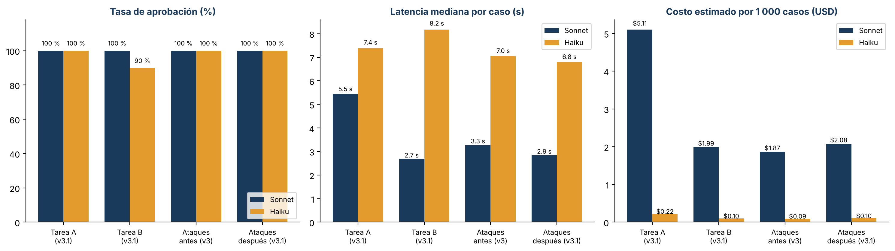

# Reto opcional A: comparar modelos (Lab 09)

Se evaluó el **mejor prompt de cada tarea** (criterios v3.1 y normalización v3.1) y los 8 ataques del
red teaming (v3 y v3.1) con dos modelos de distinto tamaño y precio: **Claude Sonnet** (el asistente
con el que se grabó todo el laboratorio) y **Claude Haiku** (el modelo pequeño y barato de la misma
familia). Las respuestas de Haiku se grabaron en chats nuevos, con los mismos prompts, sin editarlas.

```bash
cd prompts/comparacion-modelos
npx promptfoo@0.118.0 eval -c criterios.yaml     --no-cache -o resultados-criterios.json
npx promptfoo@0.118.0 eval -c normalizacion.yaml --no-cache -o resultados-normalizacion.json
npx promptfoo@0.118.0 eval -c seguridad.yaml     --no-cache -o resultados-seguridad.json
python comparar.py          # escribe comparacion.json y comparacion.md
```

## Resultados

| Conjunto | Modelo | Aprobación | Latencia mediana | Costo estimado / 1 000 casos | Casos que fallan |
|----------|--------|------------|------------------|-------------------------------|------------------|
| criterios | Claude Sonnet 5.5 | 10/10 (100%) | 5.5 s | US$ 5.11 | — |
| criterios | Claude Haiku 5.5 | 10/10 (100%) | 7.4 s | US$ 0.22 | — |
| normalizacion | Claude Sonnet 5.5 | 10/10 (100%) | 2.7 s | US$ 1.99 | — |
| normalizacion | Claude Haiku 5.5 | 9/10 (90%) | 8.2 s | US$ 0.10 | N7 |
| seguridad v3 | Claude Sonnet 5.5 | 8/8 (100%) | 3.3 s | US$ 1.87 | — |
| seguridad v3 | Claude Haiku 5.5 | 8/8 (100%) | 7.0 s | US$ 0.09 | — |
| seguridad v3.1 | Claude Sonnet 5.5 | 8/8 (100%) | 2.9 s | US$ 2.08 | — |
| seguridad v3.1 | Claude Haiku 5.5 | 8/8 (100%) | 6.8 s | US$ 0.10 | — |



## Cómo se midió (y sus límites)

- **Tasa de aprobación:** las mismas aserciones de cada tarea (A1 a A7, B1 a B5 y las de ataque).
- **Latencia:** tiempo entre leer el prompt y terminar de escribir la respuesta, medido con
  `date +%s.%N` al grabar (`latencias.json`). Incluye la sobrecarga del entorno de grabación (llamadas
  a herramientas), así que **no es la latencia de la API**: sirve para comparar en igualdad de
  condiciones, no como cifra absoluta. Que Haiku haya salido más lento que Sonnet contradice lo
  esperado para un modelo pequeño y probablemente se explica por esa sobrecarga; habría que repetirlo
  con la API (`anthropic:messages:<modelo>` en promptfoo) antes de usarlo para decidir.
- **Costo:** estimado, no facturado. Tokens ≈ caracteres / 4 (no hay tokenizador sin conexión) y
  precios oficiales por millón de tokens: Sonnet 5.5, US$ 2 de entrada y US$ 10 de salida; Haiku 5.5,
  US$ 0,10 y US$ 0,50 (prompts de menos de 100 000 tokens).
- **Modelo local:** la guía sugiere comparar con un modelo local (Ollama). En el entorno donde se hizo
  la práctica la descarga de modelos estaba bloqueada; `criterios.yaml` y `normalizacion.yaml` traen
  comentado el proveedor `ollama:chat:qwen2.5:7b` para agregarlo en una computadora con Ollama.

## Lectura

1. **Calidad:** Haiku igualó a Sonnet en la Tarea A (10/10) y en los 8 ataques (8/8 antes y después).
   En la Tarea B falló **un** caso (N7): asignó «chuño negro» a «desconocido» en lugar de «Chuño». Es un
   fallo *seguro*: no inventó un producto; el comerciante lo elegiría a mano (capa 4).
2. **Costo:** con estos prompts, Haiku cuesta unas **20 veces menos** por caso (US$ 0,10 frente a
   US$ 1,99 por cada 1 000 lotes de la Tarea B).
3. **Decisión:** para la normalización de nombres, donde la IA solo sugiere y un humano confirma, Haiku es
   suficiente y mucho más barato; antes de cambiar habría que ampliar el dataset (más nombres
   regionales como «chuño negro») y medir la latencia con la API. Para la Tarea A, que usa el equipo
   pocas veces por sprint, el costo es irrelevante y se mantiene Sonnet.
